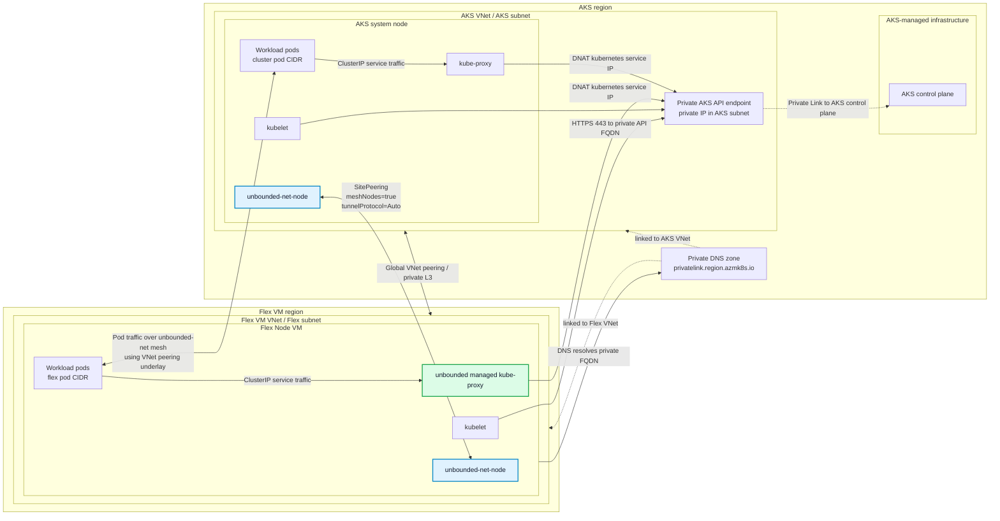

# Private AKS Cluster With Unbounded-Net And Cross-Region Flex Node

This guide shows how to create a private AKS cluster with no built-in CNI, install `unbounded-net`, connect a VM in another Azure region through VNet peering, and join that VM as an AKS Flex Node.

> [!IMPORTANT]
> This lab covers an additional configuration for evaluation. Review its status, prerequisites, and version scope before use.
>
> **Status:** Validated evaluation scenario
>
> **Last validated:** 2026-11-08
>
> **Validated versions:** AKS Kubernetes `1.36.2`, AKS Flex Node `v0.3.0`, Unbounded `v0.21.0`, Ubuntu `24.04`, and worker rootfs `v20261031`
>
> **Validated scope:** Private DNS/API access and managed-identity admin access, VNet peering, Site assignment, pool-scoped Azure Machine registration, Node readiness, bidirectional pod traffic, ClusterIP access, DNS, kubelet exec/logs callbacks, smoke cleanup, and Azure resource-group removal passed.
>
> **Validation toolchain:** Azure CLI `2.92.0`, `aks-preview` `22.0.0b8`, and kubectl `1.36.2`
>
> **Host OS:** Ubuntu 24.04
>
> **Architecture:** amd64

The validated setup uses AKS private cluster mode with `--network-plugin none` and `unbounded-net` as the CNI. Because the AKS VNet and Flex VNet are privately reachable through VNet peering, the Unbounded configuration uses `SitePeering` with `meshNodes: true` and `tunnelProtocol: Auto`. This lets `unbounded-net` own pod-to-pod connectivity through its mesh/tunnel datapath while Azure VNet peering provides node-to-node underlay reachability. Do not assign either site to a gateway pool for this topology.

For unbounded-net concepts, custom resources, and operations, see the [Unbounded networking documentation](https://unbounded-cloud.io/concepts/networking/) and [unbounded-net operations guide](https://unbounded-cloud.io/reference/networking/operations/).

## Prerequisites

- An Azure subscription where you can create resource groups, VNets, VMs, a private AKS cluster, private DNS links, and pool-scoped Azure role assignments.
- Register the preview features and verify the Flex Node Agent Role before creating resources, following the [operator prerequisites](../usage/getting-started.md#prerequisites).
- Azure CLI 2.90.0 or later, signed in to the target subscription.
- `kubectl`, `curl`, `tar`, `python3`, and SSH/SCP tools in the Bash environment or admin VM that runs the lab commands.
- A command runner that can resolve and reach the private AKS API endpoint. If your workstation cannot, use the admin VM described below.
- Non-overlapping CIDR ranges for the AKS VNet, Flex VM VNet, AKS pod CIDR, Flex pod CIDR, AKS service CIDR, and any connected networks.
- A Flex VM image with Ubuntu 24.04 and sudo access.

## What Is Unbounded-Net?

`unbounded-net` is the networking layer from [Project Unbounded](https://unbounded-cloud.io/). It provides CNI functionality and multi-site pod networking for Kubernetes clusters whose nodes may live in different networks, regions, or clouds.

In this setup, `unbounded-net` does three important things:

- Runs `unbounded-net-node` as a DaemonSet on AKS and Flex nodes. The node agent writes the host CNI config, watches `Site` and `SiteNodeSlice` resources, configures bridge/tunnel interfaces, and installs the routes needed for pod traffic.
- Allocates per-node pod CIDRs from each site's `Site` resource.
- Programs pod routes between the AKS site and Flex site using the existing VNet peering path as the node-to-node underlay.

This VNet-peered mode is intentionally different from Unbounded's public gateway mode. Since the AKS VNet and Flex VNet are already peered, the sites use `SitePeering` with `meshNodes: true` and `tunnelProtocol: Auto` so `unbounded-net` can provide the CNI mesh for pod traffic without a public `GatewayPool` or WireGuard gateway.

## Topology



- AKS cluster region: `<aks-region>`
- Flex VM region: `<vm-region>`
- AKS VNet: `<aks-vnet-cidr>`
- Flex VM VNet: `<flex-vnet-cidr>`
- AKS pod CIDR: `<cluster-pod-cidr>`
- Flex pod CIDR: `<flex-pod-cidr>`
- AKS service CIDR: `<service-cidr>`
- AKS DNS service IP: `<dns-service-ip>`

Example regions:

- AKS: `eastus2`
- Flex VM: `southcentralus`

Example CIDRs:

- AKS VNet: `10.71.0.0/16`
- AKS subnet: `10.71.1.0/24`
- Flex VM VNet: `10.72.0.0/16`
- Flex VM subnet: `10.72.1.0/24`
- AKS pod CIDR: `10.73.0.0/16`
- AKS service CIDR: `10.74.0.0/16`
- AKS DNS service IP: `10.74.0.10`
- Flex pod CIDR: `10.75.0.0/16`

Avoid CIDR overlap across the AKS VNet, Flex VNet, AKS pod CIDR, Flex pod CIDR, AKS service CIDR, and any connected networks.

## Private Link And DNS

Private AKS uses a private endpoint for the API server. VNet peering can carry traffic to that private endpoint, but DNS is not automatic across peered VNets.

After creating the AKS cluster, link the AKS private DNS zone to the Flex VM VNet. The private DNS zone is usually in the AKS node resource group and has a name like:

```text
<guid>.privatelink.<aks-region>.azmk8s.io
```

From the Flex VM, the private AKS API FQDN should resolve to a private IP and TCP 443 should connect.

```bash
getent hosts <private-aks-fqdn>
curl -k -i https://<private-aks-fqdn>:443
```

Expected unauthenticated result:

```text
HTTP/2 401
```

## Create Networks

```bash
SUBSCRIPTION_ID="<subscription-id>"
AKS_RG="<aks-resource-group>"
VM_RG="<vm-resource-group>"
AKS_REGION="<aks-region>"
VM_REGION="<vm-region>"
AKS_VNET="<aks-vnet-name>"
FLEX_VNET="<flex-vnet-name>"
AGENT_POOL_NAME="${AGENT_POOL_NAME:-aksflexnodes}"
AKS_PREVIEW_VERSION="22.0.0b8"
AKS_VERSION="1.36.2"
AKS_NODE_VM_SIZE="${AKS_NODE_VM_SIZE:-Standard_D4s_v6}"
ADMIN_VM_SIZE="${ADMIN_VM_SIZE:-Standard_D4s_v6}"
FLEX_VM_SIZE="${FLEX_VM_SIZE:-Standard_D4s_v6}"

az account set --subscription "$SUBSCRIPTION_ID"

az group create -n "$AKS_RG" -l "$AKS_REGION"
az group create -n "$VM_RG" -l "$VM_REGION"

az network vnet create \
  -g "$AKS_RG" \
  -n "$AKS_VNET" \
  -l "$AKS_REGION" \
  --address-prefixes 10.71.0.0/16 \
  --subnet-name aks-subnet \
  --subnet-prefixes 10.71.1.0/24

az network vnet create \
  -g "$VM_RG" \
  -n "$FLEX_VNET" \
  -l "$VM_REGION" \
  --address-prefixes 10.72.0.0/16 \
  --subnet-name flex-subnet \
  --subnet-prefixes 10.72.1.0/24
```

Create global VNet peering:

```bash
AKS_VNET_ID=$(az network vnet show -g "$AKS_RG" -n "$AKS_VNET" --query id -o tsv)
FLEX_VNET_ID=$(az network vnet show -g "$VM_RG" -n "$FLEX_VNET" --query id -o tsv)

az network vnet peering create \
  -g "$AKS_RG" \
  --vnet-name "$AKS_VNET" \
  -n aks-to-flex \
  --remote-vnet "$FLEX_VNET_ID" \
  --allow-vnet-access \
  --allow-forwarded-traffic

az network vnet peering create \
  -g "$VM_RG" \
  --vnet-name "$FLEX_VNET" \
  -n flex-to-aks \
  --remote-vnet "$AKS_VNET_ID" \
  --allow-vnet-access \
  --allow-forwarded-traffic
```

## Create A Private No-CNI AKS Cluster

```bash
CLUSTER_NAME="<aks-cluster-name>"
AKS_SUBNET_ID=$(az network vnet subnet show \
  -g "$AKS_RG" \
  --vnet-name "$AKS_VNET" \
  -n aks-subnet \
  --query id \
  -o tsv)

az aks create \
  -g "$AKS_RG" \
  -n "$CLUSTER_NAME" \
  -l "$AKS_REGION" \
  --vnet-subnet-id "$AKS_SUBNET_ID" \
  --kubernetes-version "$AKS_VERSION" \
  --enable-private-cluster \
  --network-plugin none \
  --pod-cidr 10.73.0.0/16 \
  --service-cidr 10.74.0.0/16 \
  --dns-service-ip 10.74.0.10 \
  --node-count 1 \
  --node-vm-size "$AKS_NODE_VM_SIZE" \
  --generate-ssh-keys
```

The AKS node starts `NotReady` until `unbounded-net` writes the CNI configuration and allocates a pod CIDR.

Create the Flex node pool used for Azure Machine registration. Before continuing, register `AKSFlexNodePreview` and `PutMachinePreview` as described in [Create a no-CNI AKS cluster](../usage/getting-started.md#1-create-a-no-cni-aks-cluster).

```bash
az extension add --name aks-preview --allow-preview true \
  --version "$AKS_PREVIEW_VERSION" --upgrade

DEADLINE=$((SECONDS + 900))
while (( SECONDS < DEADLINE )); do
  if ! STATUS=$(az aks operation show-latest -g "$AKS_RG" -n "$CLUSTER_NAME" \
    --query status -o tsv 2>/dev/null); then
    echo "Failed to query the latest AKS operation" >&2
    exit 1
  fi
  case "$STATUS" in
    InProgress|Running|Updating) sleep 15 ;;
    Succeeded) break ;;
    Failed|Canceled)
      echo "Latest AKS operation ended with status: $STATUS" >&2
      exit 1
      ;;
    *)
      echo "Unexpected AKS operation status: $STATUS" >&2
      exit 1
      ;;
  esac
done
if [[ "$STATUS" != Succeeded ]]; then
  echo "AKS operation did not finish within 15 minutes" >&2
  exit 1
fi

az aks nodepool add -g "$AKS_RG" --cluster-name "$CLUSTER_NAME" \
  --name "$AGENT_POOL_NAME" --vm-set-type FlexNodes --mode User \
  --kubernetes-version "$(az aks show -g "$AKS_RG" -n "$CLUSTER_NAME" --query currentKubernetesVersion -o tsv)" \
  --max-pods 250 --max-unavailable 1 --output none
```

## Link Private DNS To The Flex VNet

```bash
NODE_RG=$(az aks show -g "$AKS_RG" -n "$CLUSTER_NAME" --query nodeResourceGroup -o tsv)
PRIVATE_DNS_ZONE=$(az network private-dns zone list -g "$NODE_RG" --query '[0].name' -o tsv)
FLEX_VNET_ID=$(az network vnet show -g "$VM_RG" -n "$FLEX_VNET" --query id -o tsv)

az network private-dns link vnet create \
  -g "$NODE_RG" \
  -z "$PRIVATE_DNS_ZONE" \
  -n flex-vnet-link \
  -v "$FLEX_VNET_ID" \
  -e false
```

## Create An Admin VM For The Private Cluster

If your workstation cannot resolve or reach the private AKS API endpoint, create an admin VM in the Flex VNet. Use it to run `kubectl` against the private cluster.

```bash
ADMIN_VM_NAME="<admin-vm-name>"

az vm create \
  -g "$VM_RG" \
  -n "$ADMIN_VM_NAME" \
  -l "$VM_REGION" \
  --image Ubuntu2404 \
  --size "$ADMIN_VM_SIZE" \
  --vnet-name "$FLEX_VNET" \
  --subnet flex-subnet \
  --admin-username azureuser \
  --generate-ssh-keys \
  --public-ip-sku Standard \
  --assign-identity
```

If you use this VM as the Bash environment for the remaining cluster commands, install Azure CLI, `kubectl`, `curl`, `tar`, and `python3` on it. Grant its managed identity permission to retrieve the AKS administrator credential at the cluster scope:

```bash
AKS_RESOURCE_ID=$(az aks show -g "$AKS_RG" -n "$CLUSTER_NAME" --query id -o tsv)
FLEX_POOL_RESOURCE_ID="${AKS_RESOURCE_ID}/agentPools/${AGENT_POOL_NAME}"
FLEX_NODE_AGENT_ROLE_ID="8f139b0f-7eaf-460b-a9da-5b1246d9ed0d"
ADMIN_PRINCIPAL_ID=$(az vm show -g "$VM_RG" -n "$ADMIN_VM_NAME" --query identity.principalId -o tsv)

az role assignment create \
  --assignee-object-id "$ADMIN_PRINCIPAL_ID" \
  --assignee-principal-type ServicePrincipal \
  --role "Azure Kubernetes Service Cluster Admin Role" \
  --scope "$AKS_RESOURCE_ID"
```

Connect to the admin VM, authenticate with its managed identity, retrieve a dedicated kubeconfig, and verify private API access:

```bash
SUBSCRIPTION_ID="<subscription-id>"
AKS_RG="<aks-resource-group>"
CLUSTER_NAME="<aks-cluster-name>"

az login --identity
az account set --subscription "$SUBSCRIPTION_ID"

export KUBECONFIG="$HOME/.kube/aks-flex-private"
install -d -m 0700 "$HOME/.kube"
install -m 0600 /dev/null "$KUBECONFIG"
az aks get-credentials \
  --resource-group "$AKS_RG" \
  --name "$CLUSTER_NAME" \
  --admin \
  --overwrite-existing \
  --file "$KUBECONFIG"

kubectl get nodes -o wide
```

Run the remaining `kubectl` commands and Unbounded installation from the admin VM. Keep Azure resource creation and role assignment commands in your original Bash environment: the admin VM's role only permits retrieving cluster credentials. Re-export nonsecret lab variables in each environment that uses them. Allow time for the role assignment to propagate if credential retrieval initially returns an authorization error.

## Install Unbounded-Net

Install the versioned `kubectl-unbounded` plugin and bootstrap the operator:

```bash
UNBOUNDED_VERSION="v0.21.0"
case "$(uname -m)" in
  x86_64) UNBOUNDED_ARCH=amd64 ;;
  aarch64|arm64) UNBOUNDED_ARCH=arm64 ;;
  *) echo "unsupported architecture" >&2; exit 1 ;;
esac

curl -fsSLo /tmp/kubectl-unbounded.tar.gz \
  "https://github.com/Azure/unbounded/releases/download/${UNBOUNDED_VERSION}/kubectl-unbounded-linux-${UNBOUNDED_ARCH}.tar.gz" || exit 1
curl -fsSLo /tmp/unbounded-checksums.txt \
  "https://github.com/Azure/unbounded/releases/download/${UNBOUNDED_VERSION}/checksums.txt" || exit 1
(cd /tmp && awk -v archive="kubectl-unbounded-linux-${UNBOUNDED_ARCH}.tar.gz" \
  '$2 == archive {print $1 "  kubectl-unbounded.tar.gz"}' unbounded-checksums.txt | sha256sum --check --strict) || exit 1
tar -xzf /tmp/kubectl-unbounded.tar.gz -C /tmp || exit 1
sudo install -m 0755 /tmp/kubectl-unbounded /usr/local/bin/kubectl-unbounded || exit 1

kubectl unbounded version
kubectl unbounded install --timeout 60s
```

## Create Sites And Mesh Peering

Use `site init` to create the AKS cluster Site and Flex Site, including the version-compatible Site API and networking configuration. Then create a `SitePeering` for the existing private Layer 3 path.

```bash
kubectl unbounded site init \
  --name flex-southcentralus \
  --cluster-node-cidr 10.71.0.0/16 \
  --cluster-pod-cidr 10.73.0.0/16 \
  --node-cidr 10.72.0.0/16 \
  --pod-cidr 10.75.0.0/16

# site init creates gateway defaults; this topology uses node mesh instead.
kubectl delete sitegatewaypoolassignments cluster flex-southcentralus
kubectl delete gatewaypool gw-main

kubectl apply -f - <<'EOF'
apiVersion: net.unbounded-cloud.io/v1alpha1
kind: SitePeering
metadata:
  name: cluster-flex-private-l3
spec:
  sites:
  - cluster
  - flex-southcentralus
  meshNodes: true
  tunnelProtocol: Auto
EOF
```

Wait for the controller and node agent:

```bash
kubectl -n unbounded-system get pods -o wide
kubectl -n unbounded-system rollout status deploy/unbounded-net-controller --timeout=60s
kubectl -n unbounded-system rollout status ds/unbounded-net-node --timeout=60s
```

This topology does not need a public `GatewayPool`, and neither site needs a gateway pool assignment. AKS control-plane-to-Flex-kubelet traffic should use the VNet peering path, while pod-to-pod traffic is handled by the `unbounded-net` mesh selected by `tunnelProtocol: Auto`.

Verify site assignment:

```bash
kubectl get sites,sitenodeslices,sitepeerings -o wide
kubectl get nodes -L unbounded-cloud.io/site -o wide
```

Expected result after the AKS node is reconciled:

```text
site.unbounded-cloud.io/cluster               ["10.71.0.0/16"]   ...   1   1
site.unbounded-cloud.io/flex-southcentralus   ["10.72.0.0/16"]   ...

sitenodeslice.net.unbounded-cloud.io/cluster-0     cluster            0     1
```

The Flex site gets a `SiteNodeSlice` after the Flex node joins.

## Create The Flex VM

```bash
VM_NAME="<flex-vm-name>"

az vm create \
  -g "$VM_RG" \
  -n "$VM_NAME" \
  -l "$VM_REGION" \
  --image Ubuntu2404 \
  --size "$FLEX_VM_SIZE" \
  --vnet-name "$FLEX_VNET" \
  --subnet flex-subnet \
  --admin-username azureuser \
  --generate-ssh-keys \
  --public-ip-sku Standard \
  --assign-identity
```

Authorize the VM identity at the target Flex node pool scope:

```bash
AGENT_POOL_NAME="${AGENT_POOL_NAME:-aksflexnodes}"
FLEX_NODE_AGENT_ROLE_ID="8f139b0f-7eaf-460b-a9da-5b1246d9ed0d"
AKS_RESOURCE_ID=$(az aks show -g "$AKS_RG" -n "$CLUSTER_NAME" --query id -o tsv)
FLEX_POOL_RESOURCE_ID="${AKS_RESOURCE_ID}/agentPools/${AGENT_POOL_NAME}"
FLEX_PRINCIPAL_ID=$(az vm show -g "$VM_RG" -n "$VM_NAME" --query identity.principalId -o tsv)
az role assignment create --assignee-object-id "$FLEX_PRINCIPAL_ID" \
  --assignee-principal-type ServicePrincipal \
  --role "$FLEX_NODE_AGENT_ROLE_ID" --scope "$FLEX_POOL_RESOURCE_ID"
```

Verify that Azure Kubernetes Service Flex Node Agent Role is assigned at the exact pool scope, then allow the assignment to propagate before bootstrap. If Machine preflight or registration returns HTTP 403, wait and retry instead of disabling required registration.

Get the VM IPs:

```bash
VM_PRIVATE_IP=$(az vm show -g "$VM_RG" -n "$VM_NAME" --show-details --query privateIps -o tsv)
VM_PUBLIC_IP=$(az vm show -g "$VM_RG" -n "$VM_NAME" --show-details --query publicIps -o tsv)
printf 'private=%s public=%s\n' "$VM_PRIVATE_IP" "$VM_PUBLIC_IP"
```

<a id="generate-bootstrap-config"></a>
<a id="install-aks-flex-node-on-the-vm"></a>
## Bootstrap The Flex Node

Use the version-matched bootstrap script to retrieve fresh pool-issued data with the VM's managed identity. No client-side bootstrap RBAC or rendered baseline config is required.

On the Flex VM:

```bash
sudo -i

export AKS_RESOURCE_ID="<full-aks-resource-id>"
export AGENT_POOL_NAME="aksflexnodes"
export AKS_FLEX_NODE_VERSION="v0.3.0"

install -d -m 0700 /run/aks-flex-node-bootstrap
curl -fsSLo /run/aks-flex-node-bootstrap/bootstrap.sh \
  "https://raw.githubusercontent.com/Azure/AKSFlexNode/${AKS_FLEX_NODE_VERSION}/scripts/bootstrap.sh"
chmod 0700 /run/aks-flex-node-bootstrap/bootstrap.sh
bash -n /run/aks-flex-node-bootstrap/bootstrap.sh
curl -fsSLo /run/aks-flex-node-bootstrap/checksums.txt \
  "https://github.com/Azure/AKSFlexNode/releases/download/${AKS_FLEX_NODE_VERSION}/checksums.txt"
AGENT_SHA256="$(awk '$2 == "aks-flex-node-linux-amd64.tar.gz" {print $1}' /run/aks-flex-node-bootstrap/checksums.txt)"
[[ "$AGENT_SHA256" =~ ^[0-9a-f]{64}$ ]] || exit 1

bash /run/aks-flex-node-bootstrap/bootstrap.sh \
  --auth msi \
  --fetch-bootstrap-data \
  --cluster-resource-id "$AKS_RESOURCE_ID" \
  --agent-pool-name "$AGENT_POOL_NAME" \
  --agent-version "$AKS_FLEX_NODE_VERSION" \
  --agent-sha256 "$AGENT_SHA256"

rm -f /run/aks-flex-node-bootstrap/bootstrap.sh /run/aks-flex-node-bootstrap/checksums.txt
```

Use the cluster resource ID and pool name created earlier in this lab. For a user-assigned managed identity, also pass `--msi-client-id "<client-id>"`.

## DaemonSets On The Flex Node

The `unbounded-net-node` DaemonSet is installed by the Unbounded manifests and should schedule on the Flex Node automatically. It is responsible for CNI setup and site routing on the Flex Node.

`unbounded-net` also creates a site-scoped managed kube-proxy DaemonSet for each site, for example:

```text
unbounded-system/unbounded-net-kube-proxy-flex-southcentralus
```

Do not add `kubernetes.azure.com/cluster=<cluster-name>` for this unbounded-net setup. That label is only needed in the kubenet flow to make AKS-managed kube-proxy schedule on Flex Nodes. In this setup, kube-proxy for the Flex site is provided by `unbounded-net`.

## Verify

Run these commands in your private-API-connected Bash environment. Wait for registration before checking readiness:

```bash
FLEX_NODE_NAME="<flex-vm-node-name>"
kubectl wait --for=create "node/${FLEX_NODE_NAME}" --timeout=60s
kubectl wait --for=condition=Ready "node/${FLEX_NODE_NAME}" --timeout=60s
kubectl get nodes -o wide
```

Expected result:

```text
NAME                                STATUS   VERSION   INTERNAL-IP
aks-nodepool1-...                   Ready    v1.36.2   <aks-node-ip>
<flex-vm-node-name>                 Ready    v1.36.2   <flex-vm-private-ip>
```

Check sites and slices:

```bash
kubectl get sites,sitenodeslices,sitepeerings -o wide
kubectl get gatewaypools,sitegatewaypoolassignments
```

The gateway query should return no resources. Expected Site state:

```text
site.unbounded-cloud.io/cluster               ...   NODES   1   SLICES   1
site.unbounded-cloud.io/flex-southcentralus   ...   NODES   1   SLICES   1
sitepeering.net.unbounded-cloud.io/cluster-flex-private-l3   SITES   2   MESH NODES   true
```

Check pods on the Flex Node:

```bash
kubectl get pods -A --field-selector spec.nodeName=<flex-vm-node-name> -o wide
```

Expected pods:

```text
unbounded-system   unbounded-net-node-...                              Running   <flex-vm-node-name>
unbounded-system   unbounded-net-kube-proxy-flex-southcentralus-...     Running   <flex-vm-node-name>
```

Verify exec and logs through the AKS kubelet proxy path:

```bash
kubectl run flex-exec-smoke \
  --image=busybox:1.36 \
  --restart=Never \
  --overrides='{"spec":{"nodeSelector":{"kubernetes.io/hostname":"<flex-vm-node-name>"},"tolerations":[{"operator":"Exists"}]}}' \
  --command -- sh -c 'echo hello-from-flex; sleep 300'

kubectl wait --for=condition=Ready pod/flex-exec-smoke --timeout=180s
kubectl exec flex-exec-smoke -- true
kubectl logs flex-exec-smoke --tail=5
kubectl delete pod flex-exec-smoke --wait=false
```

Expected log output:

```text
hello-from-flex
```

Verify bidirectional cross-node pod traffic using the [VNet-peering smoke test](aks-public-cluster-unbounded-net-vnet-peering.md#verify), selecting the AKS node from the `cluster` Site and the Flex node from `flex-southcentralus`. Node readiness and kubelet callbacks alone don't verify the pod datapath.

## Troubleshooting

Inspect the [active nspawn worker](../usage/operations.md#nspawn-worker) on the flex node host; don't assume `kube1` after repave. The installed agent is `/opt/unbounded/agent/bin/aks-flex-node`.

For failed rollouts, inspect [Unbounded pods, events, and logs](aks-public-cluster-unbounded-net-vnet-peering.md#troubleshooting) before retrying.

Check private API reachability from the VM:

```bash
curl -k -i https://<private-aks-fqdn>:443
```

Expected unauthenticated response:

```text
HTTP/2 401
```

Check `unbounded-net` resources:

```bash
kubectl -n unbounded-system get pods -o wide
kubectl get sites,sitenodeslices,sitepeerings -o wide
kubectl get node <flex-vm-node-name> -o yaml | grep -E 'podCIDR|unbounded-cloud.io/site'
```

If `kubectl exec` or `kubectl logs` to a Flex pod fails with a `502` while the Flex node is `Ready`, check whether AKS nodes have a route for the Flex node CIDR through `unbounded0`:

```bash
ip route get <flex-vm-private-ip>
```

For this VNet-peered setup, the route to the Flex node IP should use the Azure VNet path, not `unbounded0`. Do not assign either site to a `GatewayPool`; that can advertise node CIDRs as gateway `NodeCidr` values and hijack kubelet traffic.

If pod traffic between AKS and Flex pods fails, verify the `SitePeering` has `meshNodes: true` and `tunnelProtocol: Auto`, both VNet peering objects allow VNet access and forwarded traffic, and NSGs allow node-to-node traffic between the AKS VNet and Flex VNet.

## Clean up

From the private-API-connected Bash environment or admin VM, delete the validation pods:

```bash
kubectl delete pod flex-exec-smoke aks-peering-smoke flex-peering-smoke \
  --ignore-not-found --wait=false
```

Return to the original Azure CLI environment that created the lab resources, then delete both resource groups:

```bash
az group delete --name "$AKS_RG" --yes --no-wait
az group delete --name "$VM_RG" --yes --no-wait
```

Confirm both deletions before removing local configuration or validation records:

```bash
az group exists --name "$AKS_RG"
az group exists --name "$VM_RG"
```

Both commands should eventually return `false`.
