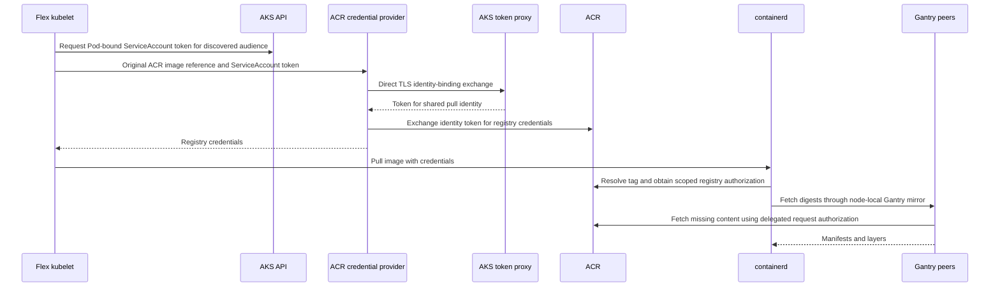

# Pull private ACR images on Flex nodes

Use AKS identity bindings to pull private Azure Container Registry (ACR) images on Linux Flex nodes without registry passwords or `imagePullSecrets`. Unbounded's Gantry attachment command configures a shared, pull-only managed identity and installs the stock ACR kubelet credential provider. Your workloads use direct image references such as `<registry>.azurecr.io/<repository>:<tag>`.

> [!IMPORTANT]
> AKS Flex Node is a preview feature. Review the prerequisites and limitations before enabling managed image-pull authentication.
>
> **Last validated:** 2026-11-10
>
> **Validated versions:** Kubernetes `1.36.2`, AKS Flex Node `v0.3.0`, Unbounded plugin/operator `v0.23.0`, stock ACR credential provider `v1.36.0`, Ubuntu `24.04`, amd64
>
> **Validated scope:** Private image pulls and Gantry peer transfer on two Azure-hosted Flex workers, idempotent reattachment, and new-worker inheritance. The AKS API was public; workers used private Layer 3 connectivity and a Premium ACR private endpoint with public registry networking disabled. Proxy-only token exchange and canonical-host mirrors failed as described below.

## How authentication works

There are two separate identities:

| Identity | Purpose |
| --- | --- |
| Host onboarding identity | Authorizes the Flex agent to register and operate its machine in the AKS Flex node pool. It can be a VM/Arc managed identity or a service principal. |
| Gantry pull identity | A separate user-assigned managed identity created by attachment, authorized to pull from the selected ACR. Current and future eligible Flex kubelets use it through AKS identity bindings. |

The pull identity is separate from both the host onboarding identity and the native AKS kubelet identity. Its identity-binding exchange does not use the Flex host's Azure Instance Metadata Service (IMDS).

### During attachment

The command:

1. Checks that your selected kubeconfig matches the requested AKS cluster and that AKS and ACR are in the same subscription.
2. Enables the AKS OIDC issuer and workload identity if necessary, then creates or reuses a pull identity named `gantry-pull-<cluster-hash>` in the AKS resource group and an AKS identity binding for it.
3. Uses an admission dry-run Pod to discover the token proxy address, TLS server name, CA, and ServiceAccount token audience. It does not schedule that Pod or collect a ServiceAccount token.
4. Grants the pull identity `AcrPull` at registry scope for a legacy-permissions registry, or `Container Registry Repository Reader` for an ABAC-enabled registry.
5. Saves the Gantry upstream and managed-auth policy. The operator installs the provider on Linux Flex nodes, grants the required token-audience permissions to those node identities, and grants use of the shared pull identity to ServiceAccounts.

The installer targets nodes labeled `kubernetes.azure.com/nodepool-type=FlexNodes`. It does not install this provider on native AKS nodes or take over conflicting customer-owned credential providers. New eligible Flex nodes inherit the policy without running attachment again.

### During an image pull



Kubelet obtains the Pod-bound token for its credential-provider request; your application does not need to request or mount an extra token. Application Pods and ServiceAccounts need no identity annotations or pull secrets.

Gantry accelerates content distribution; it does not replace kubelet authentication. Containerd answers Gantry's registry challenge using the credentials supplied by kubelet and verifies content digests. Gantry carries request-scoped authorization to a selected origin puller and discards it after the request. Tag resolution still reaches ACR.

**This is shared registry access, not tenant isolation.** The managed identity-use binding covers `system:serviceaccounts`, and the default grant is registry-wide pull access. Do not treat namespace boundaries as separate registry authorization boundaries in this configuration.

## Before you begin

Start with a working Flex deployment and operator-managed Gantry. See the [operator guide](getting-started.md) for node onboarding and networking. Select Unbounded `v0.23.0` for this procedure rather than an older version pinned by another guide. Installing a new plugin alone does not upgrade the operator.

You need:

- Azure CLI 2.90.0 or later, already signed in to the target subscription, and `kubectl` in your Bash administration environment.
- Matching Unbounded `v0.23.0` plugin, operator, and component images, and AKS Flex Node `v0.3.0` for the validated baseline.
- At least one Ready Linux Flex worker; use at least two when checking peer transfer.
- Kubelet `>=1.34` with `KubeletServiceAccountTokenForCredentialProviders` enabled. The installer checks the gate but does not enable it for you.
- AKS identity bindings available in your subscription and region; OIDC and workload identity enabled or permission to enable them. API-server VNet integration is unsupported.
- Administrative Kubernetes access and Azure permissions to read/update AKS, create identity bindings and a user-assigned identity, configure federated identity credentials, and create the registry role assignment. Resource-group Contributor alone does not grant role-assignment creation.
- No conflicting customer-owned provider configuration, kubelet command-line override, or CA file at the paths the installer owns.
- Containerd's registry `config_path` set to `/etc/containerd/certs.d`, its socket available at `/run/containerd/containerd.sock`, and reachable public or prefetched operator/Gantry installation images. Do not make installation depend on the private credentials you are about to install.

An ACR private endpoint is optional for managed authentication; it controls network access, not identity. The validated private-endpoint configuration additionally restricted where registry traffic could go.

Authentication and image delivery require different network paths:

| Path | Requirement |
| --- | --- |
| Kubelet → AKS API | Normal node API access, including TokenRequest calls. |
| Provider → discovered AKS token proxy | Direct TCP 443 with the discovered TLS server name and CA. Do not hard-code the endpoint or assume it equals the normal API hostname. |
| Provider/containerd/Gantry origin pullers → ACR | Reachable registry login/auth and data endpoints. Private endpoints require DNS and routing from every relevant node network. |
| Gantry peer → peer | TCP/QUIC 4001 for discovery, HTTP/2 5001 for transfer, TLS 5002 for coordinated origin pulls; restrict these paths to trusted peers. |
| Containerd → local Gantry | Loopback mirror on port 5000. |

Check the ACR and token-proxy routes separately. Workers do not need a separate direct connection to `login.microsoftonline.com` for the identity-binding exchange, but they must reach the discovered AKS token proxy directly, even when you configure an HTTP proxy.

For current AKS identity-binding prerequisites and availability, see:
https://learn.microsoft.com/azure/aks/identity-bindings

## Attach your registry

Run these commands in your Bash administration environment, with Azure CLI already authenticated and the version-matched plugin on `PATH`. Use an existing kubeconfig whose server hostname matches the AKS FQDN/private FQDN; a localhost tunnel alias does not pass attachment's cluster check.

```bash
set -euo pipefail

SUBSCRIPTION_ID="<subscription-id>"
AKS_RG="<aks-resource-group>"
AKS_NAME="<aks-cluster-name>"
ACR_RG="<registry-resource-group>"
ACR_NAME="<registry-name>"
KUBECONFIG_PATH="<path-to-kubeconfig>"

AKS_ID=$(az aks show --subscription "$SUBSCRIPTION_ID" \
  -g "$AKS_RG" -n "$AKS_NAME" --query id -o tsv)
ACR_ID=$(az acr show --subscription "$SUBSCRIPTION_ID" \
  -g "$ACR_RG" -n "$ACR_NAME" --query id -o tsv)
ACR_HOST=$(az acr show --subscription "$SUBSCRIPTION_ID" \
  -g "$ACR_RG" -n "$ACR_NAME" --query loginServer -o tsv)

kubectl unbounded version
kubectl --kubeconfig "$KUBECONFIG_PATH" -n unbounded-system \
  get deployment unbounded-operator \
  -o jsonpath='{.spec.template.spec.containers[*].image}{"\n"}'
kubectl --kubeconfig "$KUBECONFIG_PATH" get nodes \
  -l 'kubernetes.azure.com/nodepool-type=FlexNodes,kubernetes.io/os=linux' -o wide
```

Confirm the plugin/operator versions and at least one Ready Flex worker before continuing.

> [!WARNING]
> Managed attachment can restart **all targeted Flex kubelets concurrently**, without draining nodes. Plan a maintenance window; do not assume normal rolling-drain behavior.

```bash
kubectl unbounded gantry attach-acr \
  --kubeconfig "$KUBECONFIG_PATH" \
  --acr-resource-id "$ACR_ID" \
  --auth-mode aks-identity-binding \
  --cluster-resource-id "$AKS_ID" \
  --timeout 8m

kubectl --kubeconfig "$KUBECONFIG_PATH" -n unbounded-system \
  get ds gantry gantry-acr-auth
kubectl --kubeconfig "$KUBECONFIG_PATH" -n unbounded-system \
  get pods -l app.kubernetes.io/name=gantry-acr-auth -o wide
```

Expect one Ready installer Pod per eligible Linux Flex node. Command success confirms provider installation, not an actual private-image pull. Zero targeted nodes can satisfy the readiness check, so verify a workload next.

Specify `--auth-mode aks-identity-binding` to enable managed authentication. The default `external` mode preserves existing authentication. Attachment manages one selected registry/identity policy; it does not merge multiple managed ACR identities.

## Verify private image pulls

Use a private image with a known digest and `imagePullPolicy: Always`. The following example imports BusyBox using your Azure CLI identity, not a registry password. Run import and digest inspection from an administration environment authorized and network-enabled for your registry; registry import/network policies must allow the operation.

```bash
TEST_TAG="acr-auth-$(date -u +%Y%m%d%H%M%S)"
TEST_IMAGE="flex-validation/busybox:$TEST_TAG"

az acr import --subscription "$SUBSCRIPTION_ID" \
  -g "$ACR_RG" -n "$ACR_NAME" \
  --source docker.io/library/busybox:1.37.0 \
  --image "$TEST_IMAGE" --only-show-errors --output none

az acr repository show --subscription "$SUBSCRIPTION_ID" \
  -n "$ACR_NAME" --image "$TEST_IMAGE" --query digest -o tsv
```

Create a new namespace to avoid reusing a default ServiceAccount with existing pull secrets. Cluster-wide admission policies can still modify the test Pods, so inspect the resulting objects.

```bash
TEST_NAMESPACE="flex-acr-check-$TEST_TAG"
kubectl --kubeconfig "$KUBECONFIG_PATH" create namespace "$TEST_NAMESPACE"
kubectl --kubeconfig "$KUBECONFIG_PATH" -n "$TEST_NAMESPACE" apply -f - <<EOF
apiVersion: apps/v1
kind: DaemonSet
metadata:
  name: private-pull-check
spec:
  selector:
    matchLabels:
      app: private-pull-check
  template:
    metadata:
      labels:
        app: private-pull-check
    spec:
      nodeSelector:
        kubernetes.azure.com/nodepool-type: FlexNodes
        kubernetes.io/os: linux
      containers:
        - name: check
          image: $ACR_HOST/$TEST_IMAGE
          imagePullPolicy: Always
          command: ["sh", "-c", "sleep 3600"]
          resources:
            requests:
              cpu: 10m
              memory: 16Mi
            limits:
              memory: 64Mi
EOF

kubectl --kubeconfig "$KUBECONFIG_PATH" -n "$TEST_NAMESPACE" \
  get pods -o wide
kubectl --kubeconfig "$KUBECONFIG_PATH" -n "$TEST_NAMESPACE" \
  rollout status ds/private-pull-check --timeout=60s
kubectl --kubeconfig "$KUBECONFIG_PATH" -n "$TEST_NAMESPACE" \
  get pods -o custom-columns='NAME:.metadata.name,NODE:.spec.nodeName,IMAGE:.status.containerStatuses[0].imageID,PULL_SECRETS:.spec.imagePullSecrets[*].name'
kubectl --kubeconfig "$KUBECONFIG_PATH" -n "$TEST_NAMESPACE" \
  get serviceaccount default -o jsonpath='{.imagePullSecrets[*].name}{"\n"}'
```

Expect a Running Pod per eligible node, the expected image digest, and no Pod or ServiceAccount pull secrets. Admission policies can change the resulting Pod; inspect the actual objects, not just the submitted manifest. A successful `ctr pull` or `crictl pull` is not an equivalent test because it does not exercise kubelet's Pod-token credential-provider flow.

If a rollout fails, inspect Pod status, events, and relevant installer/kubelet logs before retrying or extending waits. Do not collect credential-provider request/response bodies, token files, complete environments/configurations, kubeconfigs, or signed URLs.

A fresh tag and `Always` exercise registry resolution but do not guarantee cold layers. To verify Gantry distribution, use an image with a new layer on at least two workers and compare before/after metrics: `p2p_peer_fetch_total{outcome="hit"}`, `gantry_peer_fetch_bytes_total`, origin bytes, and `p2p_origin_fallback_total`. Warm-cache startup alone proves neither authentication nor peer transfer. The validation run transferred a unique 32 MiB layer from one Flex node to another, with zero origin fallbacks.

## Understand proxy and mirror limits

| Configuration | Behavior in the validated releases |
| --- | --- |
| Direct ACR reference, direct token-proxy connectivity | Passed private pulls, including ACR private-endpoint access with public registry networking disabled. |
| Explicit kubelet HTTPS proxy, direct token-proxy connectivity retained | Private pull passed; identity-binding exchange bypassed the HTTP proxy. |
| Token proxy reachable only through a working CONNECT relay | Private pull failed when new direct connections were blocked; removing the block restored success. |
| Canonical `mcr.microsoft.com/...` reference mirrored to private ACR by containerd | Failed to fetch an anonymous token with HTTP 401, while the direct ACR reference worked on the same node. |

### An HTTP proxy does not replace the token-proxy route

The stock provider's identity-binding transport sets `Proxy=nil` and dials the discovered endpoint directly. `HTTPS_PROXY` cannot redirect this exchange, and `NO_PROXY` cannot create a missing route. The test verified TLS through a controlled CONNECT relay while direct connections were blocked; the provider still attempted a direct connection and the private pull failed.

This limit concerns the AKS token exchange. ACR authentication, containerd registry traffic, and Gantry origin traffic have separate transports and proxy settings. Host shell exports are not automatic configuration for nested kubelet/containerd services or Gantry Pods. The validation retained direct private ACR routing; it did not certify an end-to-end enterprise-proxy deployment.

### Containerd routing does not change kubelet's image match

Kubelet chooses a credential provider using the original image reference, before containerd resolves `hosts.toml` mirrors. Managed attachment matches only the selected ACR login host. For `mcr.microsoft.com/repository:tag`, that provider is not selected just because containerd later connects to ACR.

The stock provider has a separate `--registry-mirror` feature, but managed attachment does not configure it or broaden `matchImages`. Manually changing generated provider configuration is not a durable fix: reconciliation owns those files. A customer-owned credential-provider/mirror integration is a separate configuration, not a validated extension of this managed mode.

Use direct `<registry>.azurecr.io/...` references for this workflow. Gantry's upstream allowlist and containerd's host routing are also separate controls; attachment adds the ACR host, not arbitrary canonical registry aliases.

## Operate and troubleshoot

| Symptom or change | Check or action |
| --- | --- |
| Attachment succeeds but no workload has pulled | Confirm nonzero targeted nodes, then run the Pod-based private-pull check. |
| Identity-binding setup fails | Check subscription/region availability, Azure permissions, AKS provisioning state, OIDC/workload identity, and API-server VNet integration. |
| Installer is not Ready | Check its Pod events/logs, node label/version/gate, and ownership conflicts. Existing customer providers or incompatible kubelet overrides must be resolved explicitly. |
| Private reference enters ImagePullBackOff | Separate token-proxy DNS/TLS/direct routing from ACR login/data routing and registry RBAC propagation. ACR `/v2/` returning 401 alone does not prove a private pull or public-network access. |
| Registry grant is conditional | Attachment refuses to broaden an existing conditional grant with an unconditional one. Review authorization intent rather than adding a broad role. |
| Add a Flex node | Existing policy and operator reconciliation install its provider and audience permissions. Verify a fresh private-image Pod on the new node; do not assume node readiness proves registry authentication. |
| Repeat identical attachment | Reuses owned identity/binding/policy; neither Flex kubelet restarted in the validated no-op rerun. Changed configuration can still restart kubelets. |
| AKS token-proxy metadata changes | Rerun attachment to rediscover address, SNI, CA, and audience; node helpers do not continuously rediscover them. |
| Low DHT health in a small lab | Default `chair_cluster_size_estimate=100000` produces a capped routing target of 256. Three agents scored about 0.198, below the generic 0.7 target, despite measured peer transfer. Check peer/origin counters alongside the score. |

ABAC grants, hashed/geo ACR login names, off-Azure hosts, repave persistence, and policy removal were not live-tested. Test your actual login server; attachment and the pinned stock provider do not accept exactly the same host-name patterns.

## Clean up

Remove the test namespace when verification is complete:

```bash
kubectl --kubeconfig "$KUBECONFIG_PATH" delete namespace "$TEST_NAMESPACE" --wait=false
kubectl --kubeconfig "$KUBECONFIG_PATH" get namespace "$TEST_NAMESPACE" --ignore-not-found
```

The namespace should eventually be absent. This removes the verification workload, not the imported ACR image or managed authentication.

Do not use `attach-acr --auth-mode external` as a disable command: it preserves the existing managed policy. Removing authentication requires separate reconciliation of the node policy/files and cleanup of the Azure identity binding, federated credential, pull identity, and role assignment. Keep the installer available for node cleanup; deleting it first does not restore node files. This guide does not provide an in-place authentication rollback procedure.

For a disposable environment, delete only the dedicated Azure resource groups you created and verify deletion, including the AKS-managed node resource group. Keep shared subscription feature registrations intact.

## Related guidance

- [Join Flex nodes](joining-nodes.md)
- [Operate Flex nodes](operations.md)
- Unbounded Gantry guide and versioned implementation:
  https://github.com/Azure/unbounded/blob/v0.23.0/docs/content/guides/gantry.md
- AKS identity bindings:
  https://learn.microsoft.com/azure/aks/identity-bindings
