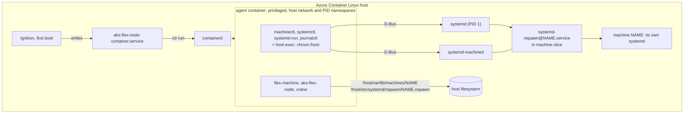

# Design: the AKS Flex Node agent as a privileged container on Azure Container Linux

> [!NOTE]
> **Status:** prototype. It proves that a privileged containerd container on
> Azure Container Linux (ACL) can manage the host's systemd-nspawn machines
> with the host's `machinectl`. The agent binary is in the image, but it does
> not run yet; see [Running the real agent](#running-the-real-agent).
> [README.md](README.md) is how to use the harness.

## Result

On ACL 3.0.20261005, from the Azure gallery image `acl-1es-eval` version
3.20261007.1021, `harness.py check` verifies all of the following:

- An Ignition config rendered from [`agent-container.bu`](agent-container.bu)
  starts the agent image with the host's containerd, on first boot and every boot
  after it. Nothing is installed on the host.
- In the container, `/host` is the host's root, and the container shares the
  host's PID namespace, but has its own root filesystem.
- `machinectl`, `systemctl`, `systemd-run`, and `journalctl` in the container
  are the host's binaries, run through `chroot /host`.
- From the container, a machine can be created from an OCI rootfs image,
  started, stopped, restarted, enabled at boot, and removed.
- From the container, `systemd-run --machine --pipe --wait`, the way the agent
  runs commands in its machines, and `machinectl shell` both reach the machine.
- Machines run in the host's `machine.slice`, not in the container. Restarting
  the agent container leaves a running machine running, with the same leader
  process.
- After a VM reboot, the agent container and an enabled machine both come back.

One finding needs the ACL team: as shipped, ACL's SELinux policy stops a
privileged container from talking to systemd over D-Bus. The prototype works
around it; see [SELinux](#selinux).

## What ACL provides

| | |
|---|---|
| OS | Microsoft Azure Container Linux 3.0.20261005 (`ID=azurelinux`, `VARIANT_ID=azurecontainerlinux`, `ID_LIKE=flatcar`) |
| Kernel | 6.6.157.1-1.azl3 |
| systemd | 255 (255-34.azl3), with `machinectl`, `systemd-nspawn`, `systemd-run`, machined, and importd; `machines.target` is enabled |
| Container runtime | containerd 2.3.4, `ctr` 2.3.4, runc 1.4.3, all in `/usr`. `containerd.service` is enabled and running. No docker, nerdctl, or podman. |
| SELinux | `targeted`, **enforcing**, compiled policy only (`/etc/selinux/targeted/policy/policy.33`); no policy store, so no `semodule` |
| Filesystems | `/usr` read-only btrfs on dm-verity and **unlabeled**; `/etc` an overlay, writable; `/` and `/var` ext4, writable |
| `/var/lib/machines` | Exists, mode 0700. `/etc/systemd/nspawn` does not, until written. |

## Architecture



### The container

[`agent-container.bu`](agent-container.bu) writes one unit,
`aks-flex-node-container.service`, and an environment file naming the image.
The unit:

1. waits for containerd to answer, since `containerd.service` on ACL reports
   started before its socket exists
2. removes a task and container a killed `ctr` may have left
3. relabels the native snapshotter's directory; see [SELinux](#selinux)
4. pulls the image, with `--local --snapshotter native`
5. runs it in the foreground with `ctr run --rm`, and restarts it whenever it exits

| `ctr run` flag | Why |
|---|---|
| `--privileged` | All capabilities and devices, no seccomp. The agent configures the kernel, network, and machines. |
| `--net-host` | The host's network. The machines share it too (`VirtualEthernet=no`), and `ctr` then also bind-mounts the host's `resolv.conf` and `hosts`. |
| `--with-ns pid:/proc/1/ns/pid` | The host's PID namespace. `systemd-run --machine` and `systemctl --machine` enter a machine's namespaces through its leader's `/proc/PID/ns`, and a process can only enter a PID namespace below its own. It also makes `/proc` under `/host` agree with the container's. |
| `--mount type=bind,src=/,dst=/host,options=rbind:rslave` | The host's root, recursively, so `/usr`, `/etc`, `/run`, `/proc`, and `/sys` under it are the host's. `rslave` lets later host mounts appear in the container, and keeps the container's mounts out of the host. |
| `--snapshotter native` | See [SELinux](#selinux). |

The container is `aks-flex-node` in containerd namespace `aks-flex`, apart from
any other containerd user. The image is built from
[`image/Containerfile`](image/Containerfile): Azure Linux 3.0 core, the agent
built with Microsoft Go as the release is, `crane`, and the scripts in
`image/bin`. It is pushed as a single layer, about 200 MB.

### Using the host's tools

The container's `machinectl`, `systemctl`, `systemd-run`, and `journalctl` are
links to [`host-exec`](image/bin/host-exec), which runs
`chroot /host /usr/bin/env PATH=... TOOL ARGS`. So:

- the host's binary runs with the host's libraries and configuration, and can't
  drift from the host's systemd, as a copy in the image could
- `/run/dbus/system_bus_socket` is the host's, so D-Bus calls reach the host's
  systemd and machined
- the process stays in the container's mount namespace and cgroup; only its root
  changes

`nsenter --target 1 --mount` would also work, given the host PID namespace, and
would leave no trace of the container's filesystem. `chroot /host` was chosen
because the agent needs both views: its own files, and the host's at `/host`.

`machinectl shell` gets its terminal from machined over D-Bus, as a file
descriptor, so it works from the container with or without a terminal of its
own.

### Machines belong to the host

[`flex-machine create`](image/bin/flex-machine) unpacks a rootfs image with
`crane export` into `/host/var/lib/machines/NAME`, and writes
`/host/etc/systemd/nspawn/NAME.nspawn` with the core settings the agent uses
(`Capability=all`, `PrivateUsers=no`, `VirtualEthernet=no`, the system call
filter, and `/lib/modules`). The default image,
`ghcr.io/azure/agent-azlinux3:v20260619`, is the one the unbounded library picks
on ACL: 141 MB compressed, 356 MB unpacked.

`machinectl start` asks the host's systemd to start
`systemd-nspawn@NAME.service`, so the machine runs in the host's cgroup tree:

| | cgroup |
|---|---|
| The unit | `/system.slice/aks-flex-node-container.service` (only `ctr`) |
| The agent container | `/aks-flex/aks-flex-node` |
| A machine | `/machine.slice/systemd-nspawn@NAME.service/payload` |

So stopping, restarting, or replacing the agent container doesn't touch the
machines, and the check confirms the machine's leader process is unchanged
across a container restart. An upgrade of the agent is a new image and a
restart of the unit, with the machines left running.

## SELinux

### The problem

Run with `ctr run --privileged`, the container's processes are `spc_t`, the
"super privileged container" domain. Its first D-Bus call is refused:

```text
avc:  denied  { send_msg } for msgtype=method_call interface=org.freedesktop.DBus member=Hello
  dest=org.freedesktop.DBus scontext=system_u:system_r:spc_t:s0
  tcontext=system_u:system_r:kernel_t:s0 tclass=dbus permissive=0
```

and `machinectl` fails with `Access denied`.

### Why

- ACL's `/usr` is unlabeled (`unlabeled_t`), so nothing on the host changes
  domain at exec. systemd, dbus-daemon, machined, sshd, containerd: every
  process is `kernel_t`.
- The policy is the usual container-selinux one. `spc_t` is meant to be
  unconfined, and may send D-Bus messages to `system_dbusd_t`, `init_t`, and
  `systemd_machined_t`, the domains those daemons run in on a labeled system.
  No rule lets it send to `kernel_t`; only `kernel_t`, `init_t`, and
  `systemd_logind_t` may.
- `kernel_t` moves to `spc_t` when it executes a file labeled
  `container_file_t`, `container_ro_file_t`, or `container_var_lib_t`. Files in
  containerd's snapshots are `container_var_lib_t`, because the policy gives
  `container_var_lib_t` to any directory `kernel_t` makes in a `var_lib_t` one.

So any container whose files containerd unpacked lands in `spc_t`, and can't
reach systemd. On a labeled host the same container would work.

### What did not work

| Attempt | Why not |
|---|---|
| `runcon` or `nsenter -Z` to `kernel_t`, from the container | `nnp_transition` denied: `ctr` sets NoNewPrivileges. With `--allow-new-privs`, `entrypoint` denied: `kernel_t` can't be entered from an `unlabeled_t` binary. |
| `process.selinuxLabel` of `kernel_t` in the OCI spec | `ctr run --config` takes a spec, but then no image: it needs an unpacked rootfs. And entering `kernel_t` from `container_var_lib_t` is not allowed either. |
| A policy module | ACL has no policy store, so `semodule` can't install one. |
| A boolean | None of the policy's booleans covers D-Bus to `kernel_t`. |

### The workaround

If the container's files are labeled with a type that has no transition, its
processes stay `kernel_t`, the domain everything else on the host already runs
in. The unit:

- uses containerd's native snapshotter, which nothing else on ACL uses, so the
  overlayfs snapshotter and any other containers are left as they are
- relabels its directory `usr_t` before each pull: `kernel_t` has no
  file-creation transition in `usr_t` directories, so new snapshots inherit it

The container then reports `system_u:system_r:kernel_t:s0`, and the whole check
runs with no SELinux denials.

What it costs:

- The native snapshotter copies instead of overlaying. Every container start
  copies the image into a fresh writable snapshot: about 20 seconds between the
  unit starting and the entrypoint's first line. Disk use is about twice the
  image, 390 MB, for a single-layer image. A layered image costs a full copy per
  layer: 1.2 GB for the same image in 7 layers, with a 97-second unpack. The
  harness squashes the image to one layer for that reason.
- The agent is as unconfined as the rest of the host. That is what a privileged
  agent with the host's root is anyway, and what the agent installed on the host,
  as PR #323 does, already is.
- It depends on today's policy and labels: `chcon` on `/var` lasts, but a
  relabel of the host, or a policy change to `usr_t`, would undo it.

The machines' own processes are `spc_t`: their root directory under
`/var/lib/machines` gets `container_var_lib_t` from the same rule, whoever
creates it. That happens with the agent on the host too. It does no harm here:
`kernel_t` may send to `spc_t`, which is what `systemd-run --machine` needs.

### For the ACL team

In order of preference:

1. **Label `/usr` in the image.** With systemd as `init_t`, dbus-daemon as
   `system_dbusd_t`, and machined as `systemd_machined_t`, the existing
   container-selinux rules already let `spc_t` talk to them, and a standard
   `ctr run --privileged`, on the default overlayfs snapshotter, would work. It
   would also make SELinux on ACL confine anything.
2. **Allow `spc_t` to send D-Bus messages to `kernel_t`**, at least
   `allow spc_t kernel_t:dbus send_msg;`, if `/usr` stays unlabeled. The
   prototype hasn't been run in `spc_t` with that rule, so there may be more.
3. **Ship a policy store**, so a policy module for the agent can be installed
   with the agent.

## Running the real agent

The image carries `aks-flex-node`, but its entrypoint only checks access and
idles. The agent, through the unbounded library, assumes it runs on the host.
Before it can run in this container:

- **Host paths.** It writes to `/etc/systemd/system`, `/etc/systemd/nspawn`,
  `/var/lib/machines`, `/etc/aks-flex-node`, `/var/log/aks-flex-node`,
  `/opt/unbounded/agent`, `/etc/sysctl.d`, `/etc/modules-load.d`, and more, as
  absolute paths. Either the unit bind-mounts each of them at the same path in
  the container, or the library takes a host root prefix; PR #323's host root
  work is a start.
- **Host commands.** It runs `systemctl`, `machinectl`, `systemd-run`,
  `systemd-nspawn`, and others by name. The `host-exec` links cover the first
  three. `ip`, `nft`, `sysctl`, and `modprobe` act on the kernel, so the
  container's own work on the host's network namespace, but the image has to
  carry them, at versions that agree with the host's kernel.
- **Self-installation.** `start` copies the agent to `/opt/unbounded/agent/bin`,
  writes `aks-flex-node-agent.service` and its recovery unit, and upgrades
  itself with blue/green binaries. In a container, the image and
  `aks-flex-node-container.service` replace all of that: an upgrade is a new
  image. These steps need turning off.
- **The nspawn lifecycle hooks.** The drop-in the agent writes for
  `systemd-nspawn@.service` runs `/opt/unbounded/agent/bin/unbounded-agent-nspawn-lifecycle`
  before and after each machine starts, from the host's systemd, outside the
  container. Either the image copies that helper to the host's `/opt` (writable
  on ACL), or the hooks move into the agent.
- **Configuration.** The bootstrap config, as PR #323's `bootstrap.env` and
  base config do, written by Ignition under `/etc/aks-flex-node`, which the
  container sees through `/host` or a bind mount.
- **Reset and uninstall** remove the container unit and image, instead of the
  agent's units and binaries.

## Security

- A privileged container with the host's PID namespace and a writable `/host` is
  root on the host. It's no less trusted than the agent installed on the host.
- The image becomes what that trust rests on. Pin it by digest in the Ignition
  config, and sign and verify it. The prototype pulls a tag over plain HTTP from
  a local registry.
- `ctr` keeps NoNewPrivileges on.

## Open questions and follow-ups

- **Cgroup placement.** `ctr` puts the container at `/aks-flex/aks-flex-node`,
  outside its unit's cgroup, so systemd neither accounts for nor limits the
  agent, and stopping the unit relies on `ExecStop` killing the task. A
  launcher using the containerd client with the systemd cgroup driver, or
  `ctr run --cgroup` with a slice, could place it under the unit.
- **`ctr` as the launcher.** It is the only container tool on ACL, but it's a
  debugging tool. A small purpose-built launcher, or an ACL-provided mechanism
  for system containers, would be sturdier.
- **Offline and first boot.** The container needs the registry at every start
  until the image is pulled. An image delivered with the OS, through a system
  extension or a `ctr image import` from Ignition, would remove the dependency.
- **Private registries.** `ctr image pull` would need credentials or a
  `hosts.toml`; MCR needs none.
- **Start time.** About 20 seconds per container start with the native
  snapshotter; near zero with overlayfs once SELinux allows it.

## Measurements

On a 16-core Intel Xeon Platinum 8370C running WSL2, with a 4-CPU, 4 GB VM:

| | |
|---|---|
| Gallery image export (first `up` only) | 90 s, 842 MiB downloaded |
| `up`, image and build cache present | about 2 min 50 s |
| ACL boot to SSH | about 16 s (systemd: 3.5 s kernel, 8 s initrd, 4 s userspace) |
| Agent container start, unit start to entrypoint | about 20 s |
| `check`, with a reboot | about 1 min 45 s |
| Agent image | about 200 MB, one layer |
| Native snapshotter use on the VM | about 390 MB |
| Machine rootfs (`agent-azlinux3`) | 141 MB compressed, 356 MB unpacked |
