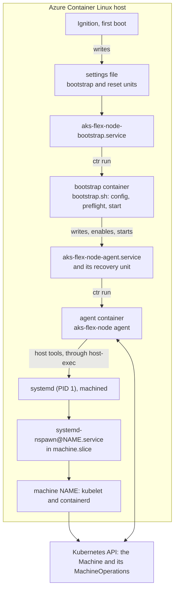

# Design: the AKS Flex Node agent in a container on Azure Container Linux

> [!NOTE]
> **Status:** development. `main`'s agent runs on Azure Container Linux (ACL)
> as privileged containerd containers of its own image, and `harness.py check`
> verifies `main`'s lifecycle against a local cluster, on ACL 3.0.20261019, the
> first build with the SELinux rule the agent needs. [README.md](README.md) is
> how to use the harness, and [TODO.md](../../TODO.md) is the remaining work.

## Result

On ACL 3.0.20261019 (build 1229918), from the Azure gallery image
`acl-1es-eval-kvm` version 3.20261019.3, joined to a local kind cluster running
`main`'s controller,
`harness.py check` verifies 68 checks, including all of the following:

- An Ignition config rendered from [`agent-container.bu`](agent-container.bu)
  installs the agent with only systemd units and settings. Its bootstrap unit
  runs `main`'s `scripts/bootstrap.sh` in a container of the agent's image,
  which joins the node: it's Ready, runs pods, and serves `kubectl logs`.
- The agent's daemon runs in a container of its image, from
  `aks-flex-node-agent.service`, `main`'s unit name, which `start` installs. No
  binary of the agent is in `/usr/local/bin` or `/usr/local/lib/aks-flex-node`,
  where `main` installs it.
- Repave, `NodeReboot`, and `AgentUpgrade` work as on a host. An `AgentUpgrade`
  names an image by digest: a good one is selected, a broken one rolls back to
  the last good image, one named by tag alone is rejected, and images the agent
  won't run again are removed.
- `AgentReset`, `aks-flex-node reset`, and the deletion signal each end as on a
  host: the agent's unit is gone, and nothing of the agent runs. What installed
  it stays, so bootstrapping again joins the node, with the install's image or
  one bootstrap is given.
- Machines run in the host's `machine.slice`, not in the container. They keep
  running while the agent's container restarts, and come back after a reboot.
  The agent's binary, which kubelet runs as its credential plugin, runs in them.

The agent's containers need one SELinux rule, `allow spc_t kernel_t:dbus
send_msg;`, which ACL 3.0.20261019 is the first to have. They run as `spc_t`, or
as `kernel_t` on that build as it ships, and every check passes either way. See
[SELinux](#selinux).

## What ACL provides

| | |
|---|---|
| OS | Microsoft Azure Container Linux 3.0.20261019, build 1229918 (`ID=azurelinux`, `VARIANT_ID=azurecontainerlinux`, `ID_LIKE=flatcar`) |
| Kernel | 6.6.158.1-1.azl3 |
| systemd | 255 (255-34.azl3), with `machinectl`, `systemd-nspawn`, `systemd-run`, machined, and importd; `machines.target` is enabled |
| Container runtime | containerd 2.3.6, `ctr` 2.3.6, runc 1.4.3, all in `/usr`. `containerd.service` is enabled and running. No docker, nerdctl, or podman. |
| SELinux | `targeted`, **enforcing**, compiled policy only (`/etc/selinux/targeted/policy/policy.33`); no policy store, so no `semodule`, but `file_contexts`, `restorecon`, and `setfiles` |
| Filesystems | `/usr` read-only btrfs on dm-verity and **unlabeled**; `/etc` an overlay, writable; `/` and `/var` ext4, writable |
| `/var/lib/machines` | Exists, mode 0700. `/etc/systemd/nspawn` does not, until written. |
| `/var/lib/containerd` | Built into the image, with an Arc agent image in a containerd namespace of its own, and **unlabeled**, though `file_contexts` labels it `container_var_lib_t` |

## Principles

- **Nothing of the agent on the host.** The host gets only configuration:
  units, settings, and the agent's data. Everything the agent does runs in a
  container of its image. The one exception left is the nspawn lifecycle
  helper; see [Machines belong to the host](#machines-belong-to-the-host).
- **`main`'s code and behavior.** The agent keeps `main`'s config, commands,
  unit name, MachineOperations, and reset. Where a container needs something
  different, `pkg/daemon` switches on `AKS_FLEX_NODE_CONTAINERIZED`, which only
  the image sets; see [What changes in the agent](#what-changes-in-the-agent).
- **Host paths at their own paths.** Each container gets only the host's root,
  at `/host`. Its entrypoint mounts the host paths the agent uses at their own
  paths, so the agent's absolute paths need no prefix.
- **The host's own tools.** `systemctl`, `machinectl`, `ctr`, and the other
  host tools the agent runs are the host's binaries, so they can't drift from
  the host's systemd and kernel.

## Architecture

### Lifecycle on Ubuntu and on ACL

| | `main` on Ubuntu | ACL |
|---|---|---|
| Install | `bootstrap.sh` downloads a release archive and installs the agent in `/usr/local/bin` | Ignition writes the settings file naming the image, and the bootstrap and reset units |
| Bootstrap's inputs | `bootstrap.sh`'s flags and `AKS_FLEX_NODE_*` variables | The same variables, in `/etc/aks-flex-node/bootstrap.env`, and optionally an image in `/etc/aks-flex-node/agent-image.env` |
| Bootstrap | `bootstrap.sh` renders the config, runs preflight, and runs `start` | The bootstrap unit runs the same `bootstrap.sh` in a container, with the agent in the image |
| `start` | Sets up the host, then installs and starts `aks-flex-node-agent.service` and its recovery unit | The same, except installing packages; the units run containers |
| Daemon start | Converges its binary layout and units | Rewrites its units from its image, copies its binary into the active machine, and removes old images |
| Repave, `NodeReboot` | The daemon replaces or restarts the active machine | The same code |
| `AgentUpgrade` | Takes `downloadURL` and `sha256`, and switches blue/green binaries | Takes `image`, and selects it in `agent-image.env` |
| Upgrade recovery | The recovery unit's script restores the last good binary | The recovery unit runs the last good image, which restores it |
| `AgentReset`, deletion signal | The daemon resets the node and removes its unit | The same code |
| `aks-flex-node reset` | Run by hand | `aks-flex-node-reset.service` runs it in a container |
| Join again | Run `bootstrap.sh` again | Write new inputs, and start the bootstrap unit |
| Uninstall | Remove the binary | Reprovision without the agent's Butane config |

## The containers

### The units

Four units run containers of the agent's image, each in containerd namespace
`aks-flex`, apart from any other containerd user:

| Unit | Container | Runs | Written by |
|---|---|---|---|
| `aks-flex-node-bootstrap.service` | `aks-flex-node-bootstrap` | `bootstrap.sh`, through the image's `aks-flex-node-bootstrap` | Ignition |
| `aks-flex-node-agent.service` | `aks-flex-node` | `aks-flex-node agent` | `start`, and the daemon at every start |
| `aks-flex-node-agent-recovery.service` | `aks-flex-node-recovery` | `aks-flex-node recover-agent-upgrade`, from the last good image | `start`, and the daemon at every start |
| `aks-flex-node-reset.service` | `aks-flex-node-reset` | `aks-flex-node reset` | Ignition |

`AgentUpgrade` also runs `aks-flex-node version` in a short-lived
`aks-flex-node-upgrade-check-N` container of the candidate image.

The agent's two units are embedded in the agent, in
[`pkg/daemon/assets`](../../pkg/daemon/assets), so they change with its image.
The bootstrap and reset units are the install's, since they run before the
agent is installed and after it's removed.

Each unit reads the install's settings, `/etc/sysconfig/aks-flex-node-container`,
then `/etc/aks-flex-node/agent-image.env` if it's there; see
[Which image](#which-image). It clears a task and container that a killed `ctr`
may have left, since both outlive it, then runs the container in the
foreground with `ctr run --rm`:

| `ctr run` flag | Why |
|---|---|
| `--privileged` | All capabilities and devices, no seccomp. The agent configures the kernel, network, and machines. |
| `--net-host` | The host's network. The machines share it too (`VirtualEthernet=no`), and `ctr` then also bind-mounts the host's `resolv.conf` and `hosts`. |
| `--with-ns pid:/proc/1/ns/pid` | The host's PID namespace. `systemd-run --machine` and `systemctl --machine` enter a machine's namespaces through its leader's `/proc/PID/ns`, and a process can only enter a PID namespace below its own. It also makes `/proc` under `/host` agree with the container's. |
| `--mount type=bind,src=/,dst=/host,options=rbind:rslave` | The host's root, recursively, so `/usr`, `/etc`, `/run`, `/proc`, and `/sys` under it are the host's. `rslave` lets later host mounts appear in the container, and keeps the container's mounts out of the host. |
| `--runc-systemd-cgroup --cgroup system-aksflex.slice:aks-flex:NAME` | runc asks systemd for a scope, `aks-flex-NAME.scope` in `system-aksflex.slice`, so systemd tracks and accounts for the container, and limits can go on the slice. Without it, `ctr` puts the container in a cgroup of its own, outside any unit. The scope is a unit of its own, so stopping a service still ends its container through `ExecStop`. |
| `--env` (the agent's unit) | The image the agent runs, and the flags for pulling and running images, for `AgentUpgrade` |
| `$AKS_FLEX_NODE_SNAPSHOTTER_RUN_ARGS` | Empty: containerd's default snapshotter. An install can name another. |

The agent's unit restarts on failure, and runs its recovery unit through
`OnFailure=`. The bootstrap unit runs at boot only while bootstrap's inputs are
there and the agent's unit isn't enabled, so it does nothing once the agent is
installed, and retries a bootstrap that failed after `start` wrote the agent's
unit. After a reset, new inputs and a start of the unit join the node again. It
retries a pull or bootstrap that fails, such as while the network comes up, for
as long as it takes, backing off from 10 seconds to 5 minutes between tries.
Each unit first waits for containerd to answer, since
`containerd.service` on ACL reports started a moment before it does.

### The image

[`image/Containerfile`](image/Containerfile) builds Azure Linux 3.0 core with:

- the agent, built with upstream Go, `go.mod`'s version, as the release is.
  The build sets the version, commit, and build time it's given, as the
  release's does. Unlike the release's, it's static, since the binary also runs
  in the machines and on the host, each with libraries of its own.
- `main`'s `scripts/bootstrap.sh`, and the tools it requires
- the scripts in [`image/bin`](image/bin)

They're in `/opt/aks-flex-node/bin`, since the container mounts the host's
`/usr/local`, which is off the image's `PATH`. Both base images are pinned by
digest. The image sets `AKS_FLEX_NODE_CONTAINERIZED=true`. It holds no
development tools: only what the agent's containers run. It's about 180 MB,
in six layers.

### The entrypoint

Every container runs [`flex-agent-entrypoint`](image/bin/flex-agent-entrypoint)
`COMMAND`. Before it runs the command, it:

1. mounts the host's `os-release` over the container's, read-only, for the
   agent's OS detection
2. mounts the host directories the agent uses at their own paths, recursively,
   and as slaves, so mounts the host makes under them later reach the
   container: `/etc/systemd`, `/etc/sysctl.d`, `/etc/modules-load.d`,
   `/etc/aks-flex-node`, `/etc/unbounded`, `/var/lib/machines`,
   `/var/lib/unbounded`, `/var/log/aks-flex-node`, `/run`, and `/usr/local`
3. mounts the install's settings read-only at their own path, for the image the
   install names
4. logs the agent's version, the host, its SELinux context, and its PID
   namespace, and checks that the host's `machinectl` answers over D-Bus

Each host path resolves within the host's root, so a host symlink, such as
`/var/lib/machines` moved to a data disk, names the host's target, not a path
in the container. A failed step exits, so the failure shows in the unit's log.
The list of paths is in the image, so it changes with the agent rather than
with the host's provisioning.

### Using the host's tools

The image links `machinectl`, `systemctl`, `systemd-run`, `systemd-nspawn`,
`journalctl`, `ip`, `nft`, `sysctl`, `modprobe`, `swapoff`, `udevadm`, `mount`,
`umount`, `mountpoint`, and `ctr` to [`host-exec`](image/bin/host-exec), and
the agent runs them by name. `host-exec` runs most of them as
`chroot /host /usr/bin/env PATH=... TOOL ARGS`:

- The host's binary runs with the host's libraries and configuration, and
  can't drift from the host's systemd or kernel, as a copy in the image could.
- `/run/dbus/system_bus_socket` and containerd's socket are the host's, so
  calls reach the host's systemd, machined, and containerd.
- The process stays in the container's cgroup; only its root changes.

`mount`, `umount`, and `mountpoint` run in the host's mount namespace instead,
through `nsenter --mount=/proc/1/ns/mnt`. The container's mounts of host paths
are slaves of the host's, so a mount or unmount made in the container's
namespace never reaches the host: an unmount of a machine's `bpffs` at reset,
for one, would leave it mounted. The entrypoint's own mounts use
`/usr/bin/mount`, the image's.

`machinectl shell` gets its terminal from machined over D-Bus, as a file
descriptor, so it works from the container with or without a terminal of its
own.

## What changes in the agent

`daemon.Containerized()` reads `AKS_FLEX_NODE_CONTAINERIZED`. On a host, where
nothing sets it, every switch takes `main`'s path:

| Where | On a host | In the container |
|---|---|---|
| `setupHost`, in `start` | Installs packages, then configures the OS | Configures the OS. The package manager on `PATH` is the image's, and would install into the container; the host's provisioning provides its packages. |
| `InstallService`, in `start` | Installs the unit that runs the binary, its recovery unit and script | Writes the container units, then enables and starts the agent's |
| `daemon.Run` | Converges the binary layout and units; upgrades by binary | Converges the units, the binary in the active machine, and the images; upgrades by image |
| `RecoverAgentUpgrade` | Restores the last good binaries | Restores the last good image, and restarts the agent's unit |
| `PreflightChecks`, in `preflight` | Every check | Leaves out `host-packages`, which would check the image's package database, and `containerd-active`, which warns that bootstrap will disable containerd |
| An `AgentUpgrade`'s parameters | `image` is invalid | `downloadURL` is invalid |

These changes apply everywhere, and leave a host's behavior as it was:

- `RemoveRuntimeDirs`, which reset uses, empties a directory it can't remove
  because it's a mount point, as the agent's directories are in its container.
  A host's never are.
- `bootstrap.sh --use-installed-agent` runs the agent already in
  `--install-dir` instead of downloading one. It's off by default.
- The handoff between an upgrading daemon and its successor goes through an
  interface, with the host's executor as one implementation and the container's
  as the other. The host's behaves as before.
- The MachineOperation reconciler validates an `AgentUpgrade`'s parameters
  before acting on it. On a host, an `image` fails it as `InvalidParameters`.

## Bootstrap

The bootstrap unit pulls the image, and runs the image's
[`aks-flex-node-bootstrap`](image/bin/aks-flex-node-bootstrap). That reads
`/etc/aks-flex-node/bootstrap.env`, one `AKS_FLEX_NODE_*=value` a line, not
evaluated as shell, and runs `bootstrap.sh --use-installed-agent` with them.
It ignores, and logs by line number, the variables the image sets: whether the
agent is containerized, where it and its config go, and which agent to
download. Secrets, such as a bootstrap token, go in a base config of their own,
named by `AKS_FLEX_NODE_BASE_CONFIG_FILE`. `bootstrap.sh` renders
`/etc/aks-flex-node/config.json`, runs preflight, and runs `start`, as on a
host.

The harness writes bootstrap's inputs through Ignition. How operators deliver
them is open; see [TODO.md](../../TODO.md).

### Which image

The install's settings name the image as `AKS_FLEX_NODE_IMAGE`. When
`/etc/aks-flex-node/agent-image.env` names another, the units run that one
instead. The bootstrap, reset, and agent's units all read it:

- `AgentUpgrade` writes it, with the last good image as
  `AKS_FLEX_NODE_LAST_GOOD_IMAGE`.
- Whatever provisions bootstrap's inputs may write it, to join with another
  image, as `bootstrap.sh`'s inputs name the agent it downloads. The agent's
  unit then keeps running it.
- Reset removes it, with the rest of `/etc/aks-flex-node`, so a join without one
  runs the install's image.

## AgentUpgrade by image

An `AgentUpgrade` in the container takes an `image`: a fully qualified
reference pinned by digest, with or without a tag. `main` requires an archive's
SHA-256, so that the agent never runs an unverified candidate, not even to
check its version. The digest is the image's equivalent: `ctr` verifies the
content it pulls against it. An image named by tag alone fails as
`InvalidParameters`, as an archive without its SHA-256 does. The parameter's
name is this branch's choice, to agree with AKS.

The upgrade follows the host's, with images for binaries:

1. The agent records the pending upgrade in its durable signal,
   `/etc/aks-flex-node/agent-upgrade-signal.json`, with the candidate image and
   the one it runs.
2. It pulls the candidate, which `ctr` verifies against its digest, and runs
   `aks-flex-node version` in it, as the host verifies the archive's SHA-256
   and runs the candidate binary before switching. As on a host, each has a
   time limit: 10 minutes for the pull, and a minute for the check, which also
   starts a container. A failed check removes its container, which
   `ctr run --rm` leaves when it's killed.
3. It selects the candidate in `agent-image.env`, with the image it runs as the
   last good one, and restarts its unit from a transient unit.
4. The new daemon converges: it rewrites the agent's units from its image, and
   copies its binary into the active machine, where kubelet runs it as its
   credential plugin. It then judges the upgrade, as on a host: the selection
   names the candidate, it runs the candidate, and the machine's binary is its
   own. It publishes the result to the MachineOperation.
5. If the new daemon fails, systemd restarts it, and `OnFailure=` starts the
   recovery unit. That runs `recover-agent-upgrade` from the last good image,
   which records the failure, selects the last good image again, and restarts
   the agent's unit. The last good daemon then reports the failure.

The recovery unit runs only while an upgrade's signal and a selection with a
last good image exist, so an ordinary failure of the agent's unit changes
nothing, as on a host.
systemd 254 and later, ACL's included, run `OnFailure=` at every failure, not
only once the unit hits its start limit, so recovery can find the unit still
restarting. The agent's unit is ordered after its recovery unit, so that
restart waits for recovery, which starts a container and takes longer than
`RestartSec=`, and runs the image recovery restored rather than the one that
failed.

Each upgrade restarts the agent's unit, and systemd counts that toward the
unit's start limit, 5 starts in 5 minutes, as on a host, where `main`'s unit
has the same limit. A restart past it fails the unit, which recovery takes for
a failed upgrade: it restores the last good image, and the upgrade is reported
failed. So an upgrade that would be the unit's sixth start in five minutes
fails, on a host too.

At every start, the daemon also removes the images upgrades pulled that it won't
run again. The agent labels each image it pulls for an upgrade, and removes only
those, never one staged, or built into the OS, for a join. It keeps the
selected one, the last good one, the install's, which bootstrap runs after a
reset, even offline, and the one it runs. It's best effort: a failed removal is
only logged, and not knowing which to keep removes none.

## Reset

There are three ways in, all `main`'s code:

- An `AgentReset` MachineOperation, which the daemon carries out
- The deletion signal, when the node's Machine is deleted
- `aks-flex-node reset`, which `aks-flex-node-reset.service` runs in a
  container

Each resets the node: it removes the machines, their `bpffs` mounts, and the
agent's config, state, bootstrap inputs, and image selection. Then
`UninstallService` removes the agent's unit and its recovery unit. When the
daemon does that itself, stopping its unit stops it, so `UninstallService`
disables the unit, removes its files, and reloads systemd before it stops the
unit.

Afterwards, nothing of the agent runs, as on a host. The settings, the
bootstrap and reset units, and the `/usr/local` overlay stay, so new inputs
and a start of the bootstrap unit join the node again.

## Machines belong to the host

`machinectl start` asks the host's systemd to start
`systemd-nspawn@NAME.service`, so each machine runs in the host's cgroup tree,
not the container's:

| | cgroup |
|---|---|
| The agent's unit | `/system.slice/aks-flex-node-agent.service` (only `ctr`) |
| The agent's container | `/system.slice/system-aksflex.slice/aks-flex-agent.scope` |
| Its other containers | Scopes beside it: `aks-flex-bootstrap`, `aks-flex-reset`, `aks-flex-recovery`, and `aks-flex-upgrade-check-N` |
| A machine | `/machine.slice/systemd-nspawn@NAME.service` |

So stopping, restarting, upgrading, or replacing the agent's container doesn't
touch the machines, and the check confirms that a machine's leader process is
unchanged across a restart of the container.

Each machine's unit runs the nspawn lifecycle helper,
`/usr/local/bin/unbounded-agent-nspawn-lifecycle`, from the host's systemd at
every start of the machine. The unbounded library installs it there as a copy
of the agent's binary, so it's the one binary of the agent left on the host.
ACL's `/usr/local` is read-only, so the install mounts a writable overlay on
it, backed by `/var/lib/aks-flex-node/usr-local`. Running the hooks in
containers of the image needs a change to unbounded; see
[TODO.md](../../TODO.md).

## SELinux

[SELINUX.md](SELINUX.md) is the full finding, written up for the ACL team.
In short:

- ACL's `/usr` is unlabeled, so every host process is `kernel_t`: systemd,
  dbus-daemon, machined, and containerd.
- A privileged container runs as `spc_t`, because executing a file of
  containerd's snapshots, labeled `container_var_lib_t` or
  `container_ro_file_t`, moves it there. Until ACL 3.0.20261019, the policy let
  `spc_t` send D-Bus messages only to the domains those daemons run in on a
  labeled host, not to `kernel_t`. So the container's first D-Bus message was
  denied, and `machinectl` and `systemctl` failed with `Access denied`.
- ACL 3.0.20261019 adds the one rule the agent needs,
  `allow spc_t kernel_t:dbus send_msg;`. With it, every host operation the
  agent performs works from `spc_t`, with no denials: `selinux-repro.sh`
  reports 0 of 59 failures, and `check` passes. `ctr` reaches containerd's
  socket from `spc_t` without a rule of its own.

### Two domains, from containerd's labels

ACL 3.0.20261019 builds `/var/lib/containerd` into the image, with an Arc agent
image, and the build leaves it unlabeled, though ACL's `file_contexts` labels
it `container_var_lib_t`. The files containerd adds later inherit `unlabeled_t`,
so nothing moves a container out of `kernel_t`, and the agent's containers run
as `kernel_t`, as every host process does. Where containerd makes the directory
itself, or `restorecon` labels it, they run as `spc_t`. The agent works either
way: `check` passes on the build as it ships, and after
`up --label-containerd`, which labels `/var/lib/containerd` with `restorecon`
before containerd first starts, and expects the domain the label implies.

| containerd's files | The agent's containers | The machines they create | `reset-failed` in recovery |
|---|---|---|---|
| Labeled, as `file_contexts` has them | `spc_t` | `kernel_t` | Allowed |
| Unlabeled, as ACL 3.0.20261019 ships them | `kernel_t` | `spc_t` | Denied |

The machines' domain follows from the agent's: a directory `kernel_t` makes in
`/var/lib/machines` is `container_var_lib_t`, whose files run as `spc_t`, while
one `spc_t` makes stays `var_lib_t`. Where `reset-failed` is denied, upgrade
recovery restarts a failed agent unit once its start limit has passed instead.

Until ACL shipped the rule, the harness had an opt-in workaround: it ran the
agent's containers on containerd's native snapshotter, its directory relabeled
`usr_t`, so they stayed `kernel_t`. It cost a copy of the image at every
container start, about 12 seconds, and is gone. [SELINUX.md](SELINUX.md)
describes it.

## Security

- A privileged container with the host's PID namespace and a writable `/host`
  is root on the host, as is the agent installed on a host. So is access to
  containerd's socket, which the agent has.
- The image is what that trust rests on, and its digest identifies it:
  containerd checks the content it pulls against it. An `AgentUpgrade`'s image
  has to be pinned by digest, and an install's should be. The host trusts
  whoever provides the digest, the install's provisioning or AKS, as `main`
  trusts the SHA-256 an `AgentUpgrade` comes with, and verifies no signature.
  Published preview images carry signed build provenance, for audits. The
  harness's install names a tag, pulled over plain HTTP from a local registry.
- Whoever can create MachineOperations for a machine can make it run an image
  of their choosing, as root, through `AgentUpgrade`. On a host, `downloadURL`
  and `sha256` grant the same, so treat the parameters as sensitive either way.
- `ctr` keeps NoNewPrivileges on.
- The harness writes bootstrap's inputs, with the bootstrap token, mode 0600,
  and reset removes them. The install's settings, which an install's pull flags
  could put credentials in, are 0600 too.

## Open questions

[TODO.md](../../TODO.md) tracks them, among them:

- image delivery: pinning, private registries, and an image shipped with the
  OS for an offline first boot
- how operators deliver bootstrap's inputs, and `--fetch-bootstrap-data` with
  the VM's identity
- the nspawn lifecycle helper
- a run on an Azure VM, and ACL in `main`'s e2e

## Measurements

On a 16-core Intel Xeon Platinum 8370C running WSL2, with a 4-CPU, 4 GB VM
whose disk writes the host caches (`cache=unsafe`):

| | |
|---|---|
| Gallery image export (first `up` only) | 70 s, 910 MiB downloaded |
| `up`, image and build cache present | about 5 min, with the kind cluster and the controller |
| ACL boot | about 13 s to systemd's startup on a reboot (3.7 s kernel, 4.8 s initrd, 4.7 s userspace) |
| First bootstrap, unit start to agent installed | about 11 s, with the image and the machine's rootfs pulled |
| Container start, unit start to entrypoint | about 1.2 s |
| `check`, with a reboot | 68 checks, 7 to 10 min, mostly downloads: each rejoin pulls the machine's image and binaries again |
| Agent image | about 180 MB, six layers |
| containerd on the VM | about 200 MB of snapshots and 340 MB of content, the image's Arc agent image included |
| Machine rootfs (`agent-azlinux3`) | 141 MB compressed, 356 MB unpacked |
