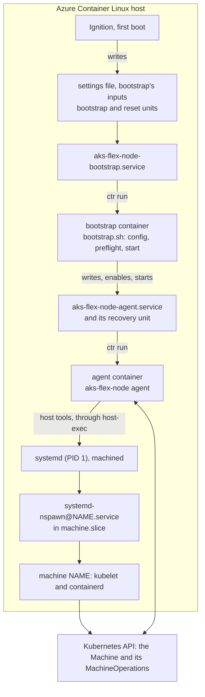

# Design: the AKS Flex Node agent in a container on Azure Container Linux

> [!NOTE]
> The AKS Flex Node agent runs on Azure Container Linux (ACL) as privileged
> containerd containers of its own image. This is how, and what differs from
> installing it on a host. [Azure Container Linux](../../docs/usage/azure-container-linux.md)
> is how operators run it, and [README.md](README.md) is how to use the harness
> that verifies it.

## Result

On ACL 3.0.20261026 (build 1236866), from the Azure gallery image
`acl-1es-eval-kvm` version 3.20261027.1, joined to a local kind cluster running
the in-cluster controller, `harness.py check` verifies 80 checks, including all
of the following:

- An Ignition config rendered from
  [`scripts/aks-flex-node-agent-container.bu`](../../scripts/aks-flex-node-agent-container.bu)
  installs the agent with only systemd units and settings. Its bootstrap unit
  runs `scripts/bootstrap.sh` in a container of the agent's image,
  which joins the node: it's Ready, runs pods, and serves `kubectl logs`.
- The agent's daemon runs in a container of its image, from
  `aks-flex-node-agent.service`, the agent's unit name on a host too, which
  `start` installs. No binary of the agent is under `/opt/unbounded/agent`,
  where a host install keeps it, or `/usr/local`, where earlier releases did.
- The machines' hooks start the agent's nspawn lifecycle units, which run its
  phases in containers of its image, at every start of a machine.
- Repave, `NodeReboot`, and `AgentUpgrade` work as on a host. An `AgentUpgrade`
  names an image and its digest: a good one is selected, a broken one rolls
  back to the last good image, requests without the digest, with it in the URL,
  or naming an archive are rejected, and images the agent won't run again are
  removed.
- `AgentReset`, `aks-flex-node reset`, and the deletion signal each end as on a
  host: the agent's unit is gone, and nothing of the agent runs. What installed
  it stays, so bootstrapping again joins the node, with the install's image or
  one bootstrap is given, and with the install's when the agent's registry is
  unreachable.
- Machines run in the host's `machine.slice`, not in the container. They keep
  running while the agent's container restarts, and come back after a reboot.
  A container that won't stop on `SIGTERM` still stops with its unit, which
  then starts again.
  The agent's binary, which kubelet runs as its credential plugin, runs in them.

The agent's containers run as `spc_t`, as ACL's labels on containerd's files
make them, and need one SELinux rule there, `allow spc_t kernel_t:dbus
send_msg;`. ACL 3.0.20261019 is the first build with the rule, and 3.0.20261026
the first to label containerd's files. See [SELinux](#selinux).

## What ACL provides

| | |
|---|---|
| OS | Microsoft Azure Container Linux 3.0.20261026, build 1236866 (`ID=azurelinux`, `VARIANT_ID=azurecontainerlinux`, `ID_LIKE=flatcar`) |
| Kernel | 6.6.159.1-1.azl3 |
| systemd | 255 (255-34.azl3), with `machinectl`, `systemd-nspawn`, `systemd-run`, machined, and importd; `machines.target` is enabled |
| Container runtime | containerd 2.3.7, `ctr` 2.3.7, runc 1.4.3, all in `/usr`. `containerd.service` is enabled and running. No docker, nerdctl, or podman. |
| SELinux | `targeted`, **enforcing**, compiled policy (`/etc/selinux/targeted/policy/policy.33`), with `file_contexts`, `restorecon`, and `setfiles` |
| Filesystems | `/usr` read-only btrfs on dm-verity and **unlabeled**; `/etc` an overlay, writable; `/` and `/var` ext4, writable |
| `/var/lib/machines` | Exists, mode 0700. `/etc/systemd/nspawn` does not, until written. |
| `/var/lib/containerd` | Built into the image, and labeled as `file_contexts` has it: `container_var_lib_t`, with containerd's snapshots `container_ro_file_t` |

## Principles

- **Nothing of the agent on the host.** The host gets only configuration:
  units, settings, and the agent's data. Everything the agent does runs in a
  container of its image, the machines' lifecycle hooks included; see
  [Machines belong to the host](#machines-belong-to-the-host).
- **The host install's code and behavior.** The agent keeps the config,
  commands, unit name, MachineOperations, and reset it has on a host. Where a
  container needs something
  different, `pkg/daemon` switches on `AKS_FLEX_NODE_CONTAINERIZED`, which only
  the image sets; see [What changes in the agent](#what-changes-in-the-agent).
- **Host paths at their own paths.** Each container gets only the host's root,
  at `/host`. Its entrypoint mounts the host paths the agent uses at their own
  paths, so the agent's absolute paths need no prefix.
- **The host's own tools.** `systemctl`, `machinectl`, `ctr`, and the other
  host tools the agent runs are the host's binaries, so they can't drift from
  the host's systemd and kernel.

## Architecture

### Lifecycle on Ubuntu and on ACL

| | On Ubuntu | On ACL |
|---|---|---|
| Install | `bootstrap.sh` downloads a release archive, and the agent installs itself under `/opt/unbounded/agent` | Ignition writes the settings file naming the image, bootstrap's inputs, and the bootstrap and reset units |
| Bootstrap's inputs | `bootstrap.sh`'s flags and `AKS_FLEX_NODE_*` variables | The same variables, in `/etc/aks-flex-node/bootstrap.env`, and optionally an image in `/etc/aks-flex-node/agent-image.env` |
| Bootstrap | `bootstrap.sh` renders the config, runs preflight, and runs `start` | The bootstrap unit runs the same `bootstrap.sh` in a container, with the agent in the image |
| `start` | Sets up the host, then installs and starts `aks-flex-node-agent.service` and its recovery unit | The same, except installing packages; the units run containers |
| Daemon start | Converges its binary layout and units | Rewrites its units from its image, copies its binary into the active machine, and removes old images |
| Repave, `NodeReboot` | The daemon replaces or restarts the active machine | The same code |
| `AgentUpgrade` | Takes `downloadURL` and `sha256`, and switches blue/green binaries | Takes an image as an `oci://` `downloadURL`, with its digest as `sha256`, and selects it in `agent-image.env` |
| Upgrade recovery | The recovery unit's script restores the last good binary | The recovery unit runs the last good image, which restores it |
| `AgentReset`, deletion signal | The daemon resets the node and removes its unit | The same code |
| `aks-flex-node reset` | Run by hand | `aks-flex-node-reset.service` runs it in a container |
| Join again | Run `bootstrap.sh` again | Write new inputs, and start the bootstrap unit |
| Uninstall | Remove the binary | Reprovision without the agent's Butane config |

## The containers

### The units

Four units run containers of the agent's image, each in containerd namespace
`aks-flex`, apart from any other containerd user:

| Unit | Container | Runs | Written by |
|---|---|---|---|
| `aks-flex-node-bootstrap.service` | `aks-flex-node-bootstrap` | `bootstrap.sh`, through the image's `aks-flex-node-bootstrap` | Ignition |
| `aks-flex-node-agent.service` | `aks-flex-node` | `aks-flex-node agent` | `start`, and the daemon at every start |
| `aks-flex-node-agent-recovery.service` | `aks-flex-node-recovery` | `aks-flex-node recover-agent-upgrade`, from the last good image | `start`, and the daemon at every start |
| `aks-flex-node-reset.service` | `aks-flex-node-reset` | `aks-flex-node reset` | Ignition |

`AgentUpgrade` also runs `aks-flex-node version` in a short-lived
`aks-flex-node-upgrade-check` container of the candidate image.

The agent's two units are embedded in the agent, in
[`pkg/daemon/assets`](../../pkg/daemon/assets), so they change with its image.
The bootstrap and reset units are the install's, since they run before the
agent is installed and after it's removed.

Each unit reads the install's settings, `/etc/sysconfig/aks-flex-node-container`,
then `/etc/aks-flex-node/agent-image.env` if it's there; see
[Which image](#which-image). It clears a task and container that a killed `ctr`
may have left, since both outlive it, then runs the container in the
foreground with `ctr run --rm`. The agent's unit also clears a recovery
container that outlived its unit, which timed out, since the agent's start
waits for recovery's:

| `ctr run` flag | Why |
|---|---|
| `--privileged` | All capabilities and devices, no seccomp. The agent configures the kernel, network, and machines. |
| `--net-host` | The host's network. The machines share it too (`VirtualEthernet=no`), and `ctr` then also bind-mounts the host's `resolv.conf` and `hosts`. |
| `--with-ns pid:/proc/1/ns/pid` | The host's PID namespace. `systemd-run --machine` and `systemctl --machine` enter a machine's namespaces through its leader's `/proc/PID/ns`, and a process can only enter a PID namespace below its own. It also makes `/proc` under `/host` agree with the container's. |
| `--mount type=bind,src=/,dst=/host,options=rbind:rslave` | The host's root, recursively, so `/usr`, `/etc`, `/run`, `/proc`, and `/sys` under it are the host's. `rslave` lets later host mounts appear in the container, and keeps the container's mounts out of the host. |
| `--runc-systemd-cgroup --cgroup system-aksflex.slice:aks-flex:NAME` | runc asks systemd for a scope, `aks-flex-NAME.scope` in `system-aksflex.slice`, so systemd tracks and accounts for the container, and limits can go on the slice. Without it, `ctr` puts the container in a cgroup of its own, outside any unit. |
| `--annotation org.systemd.property.…` | Properties runc gives the scope. `BindsTo=` the unit: systemd only kills `ctr` when a stop times out, which leaves the task running, so the scope stops with the unit instead, even when the unit's file is gone, as when the agent uninstalls its own unit. `TimeoutStopUSec=` 30 s: the scope kills what's left of the container within the units' stop timeouts, ACL's default of 45 s included, so a unit's stop ends only once its container has. `CollectMode=inactive-or-failed`: a killed scope fails, a failed scope keeps the next container from its name, and on ACL nothing may reset it, so systemd unloads it instead. |
| `--env` (the agent's unit) | The image the agent runs, and the flags for pulling and running images, for `AgentUpgrade` |
| `$AKS_FLEX_NODE_SNAPSHOTTER_RUN_ARGS` | Empty: containerd's default snapshotter. An install can name another. |

The agent's unit restarts on failure, and runs its recovery unit through
`OnFailure=`. The bootstrap unit runs at boot only while bootstrap's inputs are
there and the agent's unit isn't enabled, so it does nothing once the agent is
installed. After a reset, new inputs and a start of the unit join the node again. It
pulls the image at every bootstrap, so a tag names what it does now, as a host's
bootstrap downloads the agent its inputs name. When the pull fails, an image
already there, such as the install's after a reset, runs as it is.
It retries a bootstrap that fails, or finds no image, such as while the network
comes up, for as long as it takes, backing off from 10 seconds to 5 minutes
between tries. It doesn't retry one that retrying can't fix, for which
`bootstrap.sh` exits with 78, as on a host: a setting that can't work, or a
`start` that failed after changing the host, which then needs a reset. The unit
stays failed then, until new inputs and a start. A reset first stops the bootstrap unit, ending a bootstrap in
progress or waiting to retry, and a bootstrap started during a reset waits for
it, so the two never run at once. Each unit first waits for containerd to answer, since
`containerd.service` on ACL reports started a moment before it does.

### The image

[`Dockerfile.aks-flex-node-agent`](../../Dockerfile.aks-flex-node-agent)
builds Azure Linux 3.0 core with:

- the agent, built with upstream Go, `go.mod`'s version, as the release is.
  The build sets the version, commit, and build time it's given, as the
  release's does. Unlike the release's, it's static, since the binary also runs
  in the machines, each with libraries of its own.
- `scripts/bootstrap.sh`, and the tools it requires
- the scripts in [`scripts/agent-image`](../../scripts/agent-image)

They're in `/opt/aks-flex-node/bin`, apart from the host's `/opt/unbounded`,
which the container mounts, and which is off the image's `PATH`. Both base images are pinned by
digest. The image sets `AKS_FLEX_NODE_CONTAINERIZED=true`. It holds no
development tools: only what the agent's containers run. It's about 180 MB,
in six layers. A release publishes it as `ghcr.io/azure/aks-flex-node-agent`,
tagged with the release's version, for `linux/amd64` and `linux/arm64`, with
attested build provenance. The harness runs it on `linux/amd64` only.

### The entrypoint

Every container runs [`flex-agent-entrypoint`](../../scripts/agent-image/flex-agent-entrypoint)
`COMMAND`. Before it runs the command, it:

1. mounts the host's `os-release` over the container's, read-only, for the
   agent's OS detection
2. mounts the host directories the agent uses at their own paths, recursively,
   and as slaves, so mounts the host makes under them later reach the
   container: `/etc/systemd`, `/etc/sysctl.d`, `/etc/modules-load.d`,
   `/etc/aks-flex-node`, `/etc/unbounded`, `/var/lib/machines`,
   `/var/lib/unbounded`, `/var/log/aks-flex-node`, `/run`, and `/opt/unbounded`
3. mounts the install's settings read-only at their own path, for the image the
   install names
4. logs the agent's version, the host, its SELinux context, and its PID
   namespace, and checks that the host's `machinectl` answers over D-Bus

Each host path resolves within the host's root, so a host symlink, such as
`/var/lib/machines` moved to a data disk, names the host's target, not a path
in the container. A failed step exits, so the failure shows in the unit's log.
The list of paths is in the image, so it changes with the agent rather than
with the host's provisioning.

### Using the host's tools

The image links `machinectl`, `systemctl`, `systemd-run`, `systemd-nspawn`,
`journalctl`, `ip`, `nft`, `sysctl`, `modprobe`, `swapoff`, `udevadm`, `mount`,
`umount`, `mountpoint`, and `ctr` to [`host-exec`](../../scripts/agent-image/host-exec), and
the agent runs them by name. `host-exec` runs most of them as
`chroot /host /usr/bin/env PATH=... TOOL ARGS`:

- The host's binary runs with the host's libraries and configuration, and
  can't drift from the host's systemd or kernel, as a copy in the image could.
- `/run/dbus/system_bus_socket` and containerd's socket are the host's, so
  calls reach the host's systemd, machined, and containerd.
- The process stays in the container's cgroup; only its root changes.

`mount`, `umount`, and `mountpoint` run in the host's mount namespace instead,
through `nsenter --mount=/proc/1/ns/mnt`. The container's mounts of host paths
are slaves of the host's, so a mount or unmount made in the container's
namespace never reaches the host: an unmount of a machine's `bpffs` at reset,
for one, would leave it mounted. The entrypoint's own mounts use
`/usr/bin/mount`, the image's.

`machinectl shell` gets its terminal from machined over D-Bus, as a file
descriptor, so it works from the container with or without a terminal of its
own.

## What changes in the agent

`daemon.Containerized()` reads `AKS_FLEX_NODE_CONTAINERIZED`. On a host, where
nothing sets it, every switch takes the host's path:

| Where | On a host | In the container |
|---|---|---|
| `setupHost`, in `start` | Installs packages, then configures the OS | Configures the OS. The package manager on `PATH` is the image's, and would install into the container; the host's provisioning provides its packages. |
| `InstallService`, in `start` | Installs the unit that runs the binary, its recovery unit and script | Writes the container units, then enables and starts the agent's |
| `daemon.Run` | Converges the binary layout and units; upgrades by binary | Converges the units, the binary in the active machine, and the images; upgrades by image |
| The nspawn lifecycle units the machines' hooks start, which `StartNode` writes first and the daemon converges | Run the binary under the host root, and link the lifecycle helper to it, for hooks an earlier release writes | Run the phase in a container of the agent's image, with no helper |
| `RecoverAgentUpgrade` | Restores the last good binaries | Restores the last good image, and restarts the agent's unit |
| `PreflightChecks`, in `preflight` | Every check | Leaves out `host-packages`, which would check the image's package database, and `containerd-active`, which warns that bootstrap will disable containerd |
| An `AgentUpgrade`'s `downloadURL` | An archive's, HTTP or HTTPS; an image's, `oci://`, is invalid, as any other URL is | An image's; an archive's is invalid |
| `CredentialPlugin`, for the agent's own clients in `start` and the daemon, with a managed identity or a service principal and no bootstrap token | The host's agent, `config.HostBinaryPath` | The image's binary, which is running: the host has no agent |
| The host root's steps, in `start`, the daemon, and `nspawn-lifecycle pre-start`: migrating, preparing, and populating `/opt/unbounded/agent`, the move from `/usr/local`, and removing the binary install scripts left there | Run | Skipped: the host keeps nothing of the agent |
| Direct activation, `agent-upgrade` | Switches the binary layout | Refused: an `AgentUpgrade` names an image |
| `UninstallService`, in reset | Removes the first-boot unit, `aks-flex-node-bootstrap.service`, which runs once | Keeps it: the unit of that name is the install's bootstrap unit, which joins the node again |

Shared code serves both:

- `RemoveRuntimeDirs`, which reset uses, empties a directory it can't remove
  because it's a mount point, as the agent's directories are in its container.
  A host's never are.
- `bootstrap.sh --installed-agent PATH` runs the agent at `PATH` instead of
  installing one, as the container's bootstrap does. It's off by default.
- The handoff between an upgrading daemon and its successor goes through an
  interface, with the host's executor as one implementation and the container's
  as the other.
- `aksmachine.MachineClientOptions.CredentialPlugin` names the credential
  plugin `start`'s Machine client runs. Empty, it's the host's agent.
- The MachineOperation reconciler has the agent's executor validate an
  `AgentUpgrade`'s parameters before acting on it: the host's an archive's URL
  and SHA-256, and the container's an image's.

## Bootstrap

The bootstrap unit pulls the image, and runs the image's
[`aks-flex-node-bootstrap`](../../scripts/agent-image/aks-flex-node-bootstrap). That reads
`/etc/aks-flex-node/bootstrap.env`, one `AKS_FLEX_NODE_*=value` a line, not
evaluated as shell, and runs `bootstrap.sh --installed-agent` with them, naming
the image's agent.
It ignores, and logs by line number, the variables the image sets: whether the
agent is containerized, where it and its config go, and which agent to
download. Secrets, such as a bootstrap token, go in a base config of their own,
named by `AKS_FLEX_NODE_BASE_CONFIG_FILE`. `bootstrap.sh` renders
`/etc/aks-flex-node/config.json`, runs preflight, and runs `start`, as on a
host.

The Butane config takes `bootstrap.env` from the directory it's rendered in,
and writes it through Ignition at first boot. A base config or a service
principal's credential are entries to uncomment. After a reset, new inputs and
a start of the bootstrap unit join the node again.

### Which image

The install's settings name the image as `AKS_FLEX_NODE_IMAGE`. When
`/etc/aks-flex-node/agent-image.env` names another, the units run that one
instead. The bootstrap, reset, and agent's units all read it:

- `AgentUpgrade` writes it, with the last good image as
  `AKS_FLEX_NODE_LAST_GOOD_IMAGE`.
- Whatever provisions bootstrap's inputs may write it, to join with another
  image, as `bootstrap.sh`'s inputs name the agent it downloads. The agent's
  unit then keeps running it.
- Reset removes it, with the rest of `/etc/aks-flex-node`, so a join without one
  runs the install's image.

## AgentUpgrade by image

An `AgentUpgrade` in the container names an image in the parameters that name
an archive on a host, as Helm and Flux name OCI artifacts: `downloadURL` is
`oci://` and the image's fully qualified repository, with or without a tag, and
`sha256` is the image's digest. For an image built for several architectures,
that's its index's, which serves each of them, where a host's archive is one
architecture's. A host requires an archive's SHA-256, so that the agent never
runs an unverified candidate, not even to check its version. The digest is the
image's equivalent: `ctr` verifies the content it pulls against it. A request
without the digest fails as `InvalidParameters`, as an archive without its
SHA-256 does, and so do one with the digest in the URL, which `sha256` alone
gives, and an archive's URL. A host rejects an `oci://` URL, as it does any URL
that isn't HTTP or HTTPS.

The upgrade follows the host's, with images for binaries:

1. The agent records the pending upgrade in its durable signal,
   `/etc/aks-flex-node/agent-upgrade-signal.json`, with the candidate image and
   the one it runs, which its unit passes in, and to which a failure rolls
   back. If `agent-image.env` selects another image than the one it runs, as
   something may have written since the agent started, the upgrade fails
   rather than roll back to an image that never ran.
2. It pulls the candidate, which `ctr` verifies against its digest, and runs
   `aks-flex-node version` in it, as the host verifies the archive's SHA-256
   and runs the candidate binary before switching. As on a host, each has a
   time limit: 10 minutes for the pull, and a minute for the check, which also
   starts a container. The check clears its container before it runs and after
   it fails, as `ctr run --rm` leaves it when `ctr` is killed, and its scope is
   bound to the agent's unit.
3. It selects the candidate in `agent-image.env`, with the image it runs as the
   last good one, resets its unit's start-limit count, and restarts the unit
   from a transient unit.
4. The new daemon converges: it copies its binary into the active machine,
   where kubelet runs it as its credential plugin, but keeps the last good
   version's units, which recovery runs through, as a host's daemon keeps its
   service assets. It then judges the upgrade, as on a host: the selection
   names the candidate, it runs the candidate, and the machine's binary is its
   own. It publishes the result to the MachineOperation, and only then writes
   the agent's units from its image.
5. If the new daemon fails, systemd restarts it, and `OnFailure=` starts the
   recovery unit. That runs `recover-agent-upgrade` from the last good image,
   which records the failure, selects the last good image again, and restarts
   the agent's unit. The last good daemon then reports the failure.

The recovery unit runs only while an upgrade's signal and a selection with a
last good image exist, so an ordinary failure of the agent's unit changes
nothing, as on a host.
systemd 254 and later, ACL's included, run `OnFailure=` at every failure, not
only once the unit hits its start limit, so recovery can find the unit still
restarting. The agent's unit is ordered after its recovery unit, so that
restart waits for recovery, which starts a container and takes longer than
`RestartSec=`, and runs the image recovery restored rather than the one that
failed.

The agent's unit allows 5 starts in 5 minutes, as a host's does, and systemd
counts deliberate restarts too. So before each upgrade's restart, the daemon
resets the unit's start count, as it does on a host, and several upgrades
in a row aren't refused. Recovery resets it too, before it restarts the unit on
the last good image.

At every start, the daemon also removes the images upgrades pulled that it won't
run again. The agent labels each image as it pulls it for an upgrade, and
removes only those, never one staged, or built into the OS, for a join. It
keeps the selected one, the last good one, the install's, which bootstrap runs
after a reset, and the one it runs. It's best effort: a failed
removal is only logged, and not knowing which to keep removes none. Each call
to containerd has a minute: the daemon does this before it reports an upgrade
or reconciles, and its unit counts as started already, so a call that hung
would hold it there.

## Reset

There are three ways in, all the host's code:

- An `AgentReset` MachineOperation, which the daemon carries out
- The deletion signal, when the node's Machine is deleted
- `aks-flex-node reset`, which `aks-flex-node-reset.service` runs in a
  container

Each resets the node, removing the machines, their `bpffs` mounts, and the
agent's config, state, bootstrap inputs, and image selection, and runs
`UninstallService`, which removes the agent's unit and its recovery unit. The
daemon resets the node first, while `aks-flex-node reset` uninstalls first, as
on a host. When the daemon uninstalls its own unit, stopping the unit stops it,
so `UninstallService` disables the unit, removes its files, and reloads systemd
before it stops the unit. Stopping the unit stops its container's scope too, as
it's bound to the unit, so `aks-flex-node reset` resets the node only once the
daemon has stopped, even one that doesn't stop on `SIGTERM`.

Afterwards, nothing of the agent runs, as on a host. The settings, and the
bootstrap and reset units, stay, so new inputs and a start of the bootstrap
unit join the node again.

## Machines belong to the host

`machinectl start` asks the host's systemd to start
`systemd-nspawn@NAME.service`, so each machine runs in the host's cgroup tree,
not the container's:

| | cgroup |
|---|---|
| The agent's unit | `/system.slice/aks-flex-node-agent.service` (only `ctr`) |
| The agent's container | `/system.slice/system-aksflex.slice/aks-flex-agent.scope` |
| Its other containers | Scopes beside it: `aks-flex-bootstrap`, `aks-flex-reset`, `aks-flex-recovery`, `aks-flex-upgrade-check`, and each machine's `aks-flex-nspawn-pre-start-NAME` and `aks-flex-nspawn-post-start-NAME` |
| A machine | `/machine.slice/systemd-nspawn@NAME.service` |

So stopping, restarting, upgrading, or replacing the agent's container doesn't
touch the machines, and the check confirms that a machine's leader process is
unchanged across a restart of the container.

At every start of a machine, its hooks start the agent's nspawn lifecycle
units, `aks-flex-node-nspawn-pre-start@.service` before it and
`aks-flex-node-nspawn-post-start@.service` once it has started, as on a host.
In the container's units, each runs its phase, `aks-flex-node nspawn-lifecycle`,
in a short-lived container of the image the agent's unit runs. That image is on
the host, so a machine's start pulls nothing, and the machines start without the
agent's daemon.

An earlier preview left a copy of the agent's binary on the host,
`/opt/unbounded/agent/bin/unbounded-agent-nspawn-lifecycle`, which its hooks
ran. The daemon rewrites the active machine's hooks and removes the copy at its
start, once no `AgentUpgrade` is pending: until it's judged, the last good
image's hooks may run it.

## SELinux

We raised what the agent's containers needed with the ACL team, who changed
their builds:

- ACL's `/usr` is unlabeled, so every host process is `kernel_t`: systemd,
  dbus-daemon, machined, and containerd.
- A privileged container runs as `spc_t`, because executing a file of
  containerd's snapshots, labeled `container_var_lib_t` or
  `container_ro_file_t`, moves it there. Until ACL 3.0.20261019, the policy let
  `spc_t` send D-Bus messages only to the domains those daemons run in on a
  labeled host, not to `kernel_t`. So the container's first D-Bus message was
  denied, and `machinectl` and `systemctl` failed with `Access denied`.
- ACL 3.0.20261019 adds the one rule the agent needs,
  `allow spc_t kernel_t:dbus send_msg;`. With it, every host operation the
  agent performs works from `spc_t`, with no denials, and `check` passes.
  `ctr` reaches containerd's socket from `spc_t` without a rule of its own.

### containerd's labels

ACL builds `/var/lib/containerd` into the image. From 3.0.20261026 it's
labeled as ACL's `file_contexts` has it, `container_var_lib_t`, with
containerd's snapshots `container_ro_file_t`, and the files containerd adds
inherit the labels. So the agent's containers run as `spc_t`, which may
`reset-failed` the agent's unit, as upgrades and their recovery do, and the
machines they create run as `kernel_t`: a directory `spc_t` makes in
`/var/lib/machines` stays `var_lib_t`. Earlier builds left the directory
unlabeled, so every container containerd started stayed `kernel_t`, which may
not. ACL tests its builds for the labels now, and the agent needs them: `check`
expects `spc_t`, and fails on an unlabeled build.

Until ACL shipped the rule, the harness had an opt-in workaround: it ran the
agent's containers on containerd's native snapshotter, its directory relabeled
`usr_t`, so they stayed `kernel_t`. It cost a copy of the image at every
container start, about 12 seconds, and is gone.

## Security

- A privileged container with the host's PID namespace and a writable `/host`
  is root on the host, as is the agent installed on a host. So is access to
  containerd's socket, which the agent has.
- The image is what that trust rests on, and its digest identifies it:
  containerd checks the content it pulls against it. An `AgentUpgrade` has to
  give its image's digest, and an install's image should be pinned by it. The
  host trusts whoever provides the digest, the install's provisioning or AKS,
  as a host install trusts the SHA-256 an `AgentUpgrade` comes with, and verifies no
  signature. Released images carry attested build provenance, for audits. The
  harness's install names a tag, pulled over plain HTTP from a local registry.
- Whoever can create MachineOperations for a machine can make it run an image
  of their choosing, as root, through `AgentUpgrade`, as on a host they can make
  it run an archive of their choosing, so treat the parameters as sensitive.
- `ctr` keeps NoNewPrivileges on.
- The harness writes bootstrap's inputs, with the bootstrap token, mode 0600,
  and reset removes them. The install's settings are 0600 too.
- The pull and snapshotter flags in the install's settings appear on `ctr`'s
  command lines, which other local users can read through `/proc`. Never put
  registry credentials in them. Pulling the agent's image from a registry that
  needs credentials isn't supported yet.

## Open questions

- GPU hosts: the agent's containers find the image's NVIDIA tools, not the
  host's ([#416](https://github.com/Azure/AKSFlexNode/issues/416)).
- Swap in the host's `/etc/fstab` comes back after a reboot
  ([#417](https://github.com/Azure/AKSFlexNode/issues/417)).
- A run on an Azure VM, with `--fetch-bootstrap-data`, and ACL in the E2E tests
  ([#399](https://github.com/Azure/AKSFlexNode/issues/399)).
- How ACL hosts take OS updates
  ([#379](https://github.com/Azure/AKSFlexNode/issues/379)).

## Measurements

On a 16-core Intel Xeon Platinum 8370C running WSL2, with a 4-CPU, 4 GB VM
whose disk writes the host caches (`cache=unsafe`):

| | |
|---|---|
| Gallery image export (first `up` only) | 70 s, 910 MiB downloaded |
| `up`, image and build cache present | about 5 min, with the kind cluster and the controller |
| ACL boot | about 13 s to systemd's startup on a reboot (3.7 s kernel, 4.8 s initrd, 4.7 s userspace) |
| First bootstrap, unit start to agent installed | about 11 s, with the image and the machine's rootfs pulled |
| Container start, unit start to entrypoint | about 1.2 s |
| `check`, with a reboot | 80 checks, 7 to 10 min, mostly downloads: each rejoin pulls the machine's image and binaries again |
| Agent image | about 180 MB, six layers |
| containerd on the VM | about 200 MB of snapshots and 340 MB of content, the image's Arc agent image included |
| Machine rootfs (`agent-azlinux3`) | 141 MB compressed, 356 MB unpacked |
