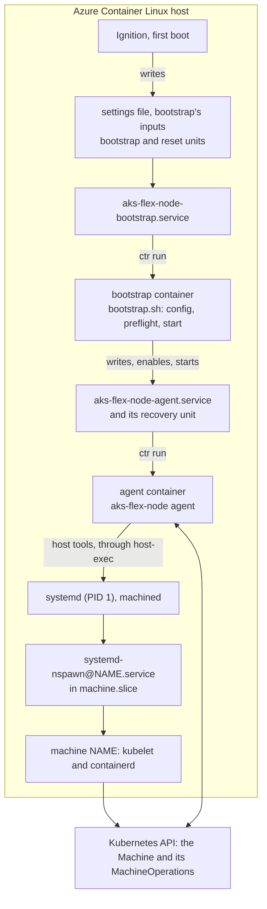

# Design: the AKS Flex Node agent in containers on Azure Container Linux

> [!WARNING]
> Azure Container Linux support is experimental, and not for production nodes.
> See the limits in [Azure Container Linux](../../docs/usage/azure-container-linux.md).

On Azure Container Linux (ACL), the agent can run as privileged containerd
containers of its own image. This document explains how, and why. It calls that
the **container install**. The **binary install** is the agent installed on the
host, under `/opt/unbounded/agent`: on Ubuntu, or on ACL through
[`scripts/aks-flex-node-bootstrap.bu`](../../scripts/aks-flex-node-bootstrap.bu).

- [Azure Container Linux](../../docs/usage/azure-container-linux.md) is how
  operators run the container install.
- [README.md](README.md) is how to run the harness that tests it: what it
  checks, and the environment it was tested in.

## Principles

- **Nothing of the agent on the host.** The host gets only units, settings, and
  the agent's data. Everything the agent does runs in a container of its image,
  the machines' lifecycle hooks included.
- **The binary install's code and behavior.** The agent keeps its config,
  commands, unit name, MachineOperations, and reset. Where the container needs
  something different, `pkg/daemon` switches on `AKS_FLEX_NODE_CONTAINERIZED`,
  which only the image sets; see [What changes in the agent](#what-changes-in-the-agent).
- **Host paths at their own paths.** Each container gets the host's root at
  `/host`. Its entrypoint mounts the host paths the agent uses at their own
  paths, so the agent's absolute paths need no prefix.
- **The host's own tools.** `systemctl`, `machinectl`, `ctr`, and the other
  tools the agent runs are the host's binaries, so they match the host's
  systemd and kernel.

## Architecture

| | Binary install | Container install |
|---|---|---|
| Install | `bootstrap.sh` downloads a release archive, and the agent installs itself under `/opt/unbounded/agent` | Ignition writes the settings, bootstrap's inputs, and the bootstrap and reset units |
| Bootstrap | `bootstrap.sh` renders the config, runs preflight, and runs `start` | The bootstrap unit runs the same `bootstrap.sh` in a container, with the image's agent |
| `start` | Sets up the host, then installs and starts `aks-flex-node-agent.service` and its recovery unit | The same, without installing packages; the units run containers |
| Daemon start | Converges its binary layout and units | Converges its units, copies its binary into the active machine, and removes old images |
| `AgentUpgrade` | Names a release archive, and switches blue/green binaries | Names an image, and selects it in `agent-image.env` |
| Upgrade recovery | The recovery unit's script restores the last good binary | The recovery unit runs the last good image, which selects itself again |
| `aks-flex-node reset` | Run on the host | `aks-flex-node-reset.service` runs it in a container |
| Joining again after a reset | Run `bootstrap.sh` again | Write new inputs, and start the bootstrap unit |
| Uninstall | `scripts/uninstall.sh` | Reprovision without the agent's Butane config |

Repave, `NodeReboot`, `AgentReset`, and the deletion signal run the same code in
both.

### Units and files

Six units run containers of the agent's image, in containerd's `aks-flex`
namespace:

| Unit | Container | Runs | Written by |
|---|---|---|---|
| `aks-flex-node-bootstrap.service` | `aks-flex-node-bootstrap` | `bootstrap.sh`, through the image's `aks-flex-node-bootstrap` | Ignition |
| `aks-flex-node-reset.service` | `aks-flex-node-reset` | `aks-flex-node reset` | Ignition |
| `aks-flex-node-agent.service` | `aks-flex-node` | `aks-flex-node agent` | `start`, and the daemon at every start |
| `aks-flex-node-agent-recovery.service` | `aks-flex-node-recovery` | `aks-flex-node recover-agent-upgrade`, from the last good image | `start`, and the daemon at every start |
| `aks-flex-node-nspawn-pre-start@.service` | `aks-flex-node-nspawn-pre-start-NAME` | `aks-flex-node nspawn-lifecycle pre-start NAME` | `start`, and the daemon at every start |
| `aks-flex-node-nspawn-post-start@.service` | `aks-flex-node-nspawn-post-start-NAME` | `aks-flex-node nspawn-lifecycle post-start NAME` | `start`, and the daemon at every start |

`AgentUpgrade` also runs `aks-flex-node version` in a short-lived
`aks-flex-node-upgrade-check` container of the candidate image.

The agent's four units are embedded in it, in
[`pkg/daemon/assets`](../../pkg/daemon/assets), so they change with its image.
The bootstrap and reset units are the install's, in
[`scripts/aks-flex-node-agent-container.bu`](../../scripts/aks-flex-node-agent-container.bu):
they run before the agent is installed and after it's removed.

| File | Holds | Written by | After a reset |
|---|---|---|---|
| `/etc/sysconfig/aks-flex-node-container` | The install's settings: `AKS_FLEX_NODE_IMAGE`, and optional pull and snapshotter flags | Ignition | Kept |
| `/etc/aks-flex-node/bootstrap.env`, `base-config.json` | Bootstrap's inputs, one `AKS_FLEX_NODE_*` variable a line, and the base config they name | Ignition, or whatever provisions a rejoin | Removed once bootstrap succeeds, or fails with the agent's unit installed |
| `/etc/aks-flex-node/credentials/` | A service principal's credential, which the agent reads | Ignition, or whatever provisions a rejoin | Removed |
| `/etc/aks-flex-node/agent-image.env` | The image selection: `AKS_FLEX_NODE_IMAGE`, with `AKS_FLEX_NODE_LAST_GOOD_IMAGE` after an upgrade | `AgentUpgrade`, or whatever provisions a rejoin | Removed |
| `/etc/aks-flex-node/agent-upgrade-signal.json` | A pending `AgentUpgrade` | The daemon | Removed |

The units read the settings, then the selection, which overrides the install's
image. Reset empties `/etc/aks-flex-node`, so a rejoin without a new selection
runs the install's image.

### How a unit runs its container

Each unit waits for containerd to answer, since `containerd.service` reports
started a moment before it does. It then clears the task and container that a
killed `ctr` leaves behind, and runs the container in the foreground with
`ctr run --rm`. The agent's unit also clears a recovery container that outlived
its unit. The flags:

| `ctr run` flag | Why |
|---|---|
| `--privileged` | All capabilities and devices, and no seccomp: the agent configures the kernel, the network, and machines. |
| `--net-host` | The host's network, which the machines share. `ctr` then also bind-mounts the host's `resolv.conf` and `hosts`. |
| `--with-ns pid:/proc/1/ns/pid` | The host's PID namespace. `systemd-run --machine` and `systemctl --machine` enter a machine's namespaces through its leader's `/proc/PID/ns`, and a process can only enter a PID namespace below its own. |
| `--mount type=bind,src=/,dst=/host,options=rbind:rslave` | The host's root, recursively. `rslave` lets later host mounts reach the container, and keeps the container's mounts off the host. |
| `--runc-systemd-cgroup --cgroup system-aksflex.slice:aks-flex:NAME` | A scope, `aks-flex-NAME.scope`, so systemd tracks and accounts for the container. Without it, `ctr` puts the container in a cgroup outside any unit. |
| `--annotation org.systemd.property.BindsTo=…` | The scope stops with its unit, even when systemd only kills `ctr`, or the unit's file is gone, as when the agent uninstalls its own unit. |
| `--annotation org.systemd.property.TimeoutStopUSec=…` | The scope kills what's left of the container after 30 s, within the units' stop timeouts, so a unit's stop ends only once its container has. |
| `--annotation org.systemd.property.CollectMode=…` | A killed scope fails, and a failed scope would keep the next container from its name, so systemd unloads it even then. |
| `--env` | For the agent's unit: the image it runs, and the flags to pull and run images with, for `AgentUpgrade`. |
| `$AKS_FLEX_NODE_SNAPSHOTTER_RUN_ARGS` | Empty: containerd's default snapshotter. An install can name another. |

The agent's unit restarts on failure, and starts its recovery unit through
`OnFailure=`; see [AgentUpgrade by image](#agentupgrade-by-image).

### The bootstrap unit

| | |
|---|---|
| When it runs | At boot, while `bootstrap.env` exists and the agent's unit isn't enabled. After a reset, when started by hand. |
| Its image | Pulled at every run, so a tag names its current image. If the pull fails, an image already on the host, such as the install's after a reset, runs as it is. |
| Its inputs | `bootstrap.env`, which the image's [`aks-flex-node-bootstrap`](../../scripts/agent-image/aks-flex-node-bootstrap) reads: one `AKS_FLEX_NODE_*=value` a line, not evaluated as shell. It ignores, with a warning, the variables the image sets: where the agent and its config go, and which agent to download. Secrets go in files the inputs name. |
| What it runs | `bootstrap.sh --installed-agent`, naming the image's agent: it renders `/etc/aks-flex-node/config.json`, runs preflight, and runs `start`. |
| Success | It removes `bootstrap.env` and `base-config.json`. A service principal's credential stays. |
| A failure | Retried for as long as it takes, backing off from 10 seconds to 5 minutes. |
| Exit status 78 | Not retried: a setting that can't work, or a `start` that failed after changing the host. The unit stays failed until new inputs and a start. |
| A reset | The reset unit stops it first, and a bootstrap started during a reset waits for the reset. |

### The image

[`Dockerfile.aks-flex-node-agent`](../../Dockerfile.aks-flex-node-agent)
builds Azure Linux 3.0 core with:

- the agent, built with upstream Go, as the release is, but static, since the
  binary also runs in the machines, each with libraries of its own
- `scripts/bootstrap.sh`, and the tools it requires
- the scripts in [`scripts/agent-image`](../../scripts/agent-image)

They're in `/opt/aks-flex-node/bin`, the only directory of the image's on
`PATH`. They can't be in `/opt/unbounded`, since the entrypoint mounts the
host's over it. The image sets `AKS_FLEX_NODE_CONTAINERIZED=true`, and holds no
development tools. Every image its build pulls is pinned by digest. A release
publishes it as `ghcr.io/azure/aks-flex-node-agent` for `linux/amd64` and
`linux/arm64`, tagged with the version and the commit, with attested build
provenance.

### The entrypoint

Every container runs
[`flex-agent-entrypoint`](../../scripts/agent-image/flex-agent-entrypoint)
`COMMAND`. Before it runs the command, it:

1. mounts the host's `os-release` over the container's, read-only, for the
   agent's OS detection
2. mounts the host directories the agent uses at their own paths, recursively,
   and as slaves, so later host mounts under them reach the container:
   `/etc/systemd`, `/etc/sysctl.d`, `/etc/modules-load.d`, `/etc/aks-flex-node`,
   `/etc/unbounded`, `/var/lib/machines`, `/var/lib/unbounded`,
   `/var/log/aks-flex-node`, `/run`, and `/opt/unbounded`
3. mounts the install's settings read-only at their own path
4. logs the agent's version, the host, its SELinux context, and its PID
   namespace, and checks that the host's `machinectl` answers over D-Bus

Each host path resolves within the host's root, so a host symlink, such as
`/var/lib/machines` moved to a data disk, names the host's target. A failed
step exits, so the failure shows in the unit's log. The list of paths is in the
image, so it changes with the agent rather than with the host's provisioning.

### The host's tools

The image links `machinectl`, `systemctl`, `systemd-run`, `systemd-nspawn`,
`journalctl`, `ip`, `nft`, `sysctl`, `modprobe`, `swapoff`, `udevadm`, `mount`,
`umount`, `mountpoint`, and `ctr` to
[`host-exec`](../../scripts/agent-image/host-exec), and the agent runs them by
name. `host-exec` runs most of them as `chroot /host /usr/bin/env PATH=... TOOL
ARGS`, so:

- the host's binary runs with the host's libraries and configuration
- the D-Bus and containerd sockets are the host's, so calls reach the host's
  systemd, machined, and containerd
- the process stays in the container's cgroup; only its root changes

`mount`, `umount`, and `mountpoint` run in the host's mount namespace instead,
through `nsenter --mount=/proc/1/ns/mnt`. The container's mounts of host paths
are slaves of the host's, so a mount or unmount in the container's namespace
never reaches the host: reset's unmount of a machine's `bpffs`, for one, would
leave it mounted. The entrypoint's own mounts use the image's `mount`.

## What changes in the agent

`daemon.Containerized()` reads `AKS_FLEX_NODE_CONTAINERIZED`. In the binary
install, nothing sets it, and every switch takes the binary install's path:

| Where | Binary install | Container install |
|---|---|---|
| `setupHost`, in `start` | Installs packages, then configures the OS | Configures the OS. The package manager on `PATH` is the image's, and would install into the container. |
| `InstallService`, in `start` | Installs the unit that runs the binary, and its recovery unit and script | Writes the container's units, then enables and starts the agent's |
| `daemon.Run` | Converges the binary layout and units; upgrades by binary | Converges the units, the binary in the active machine, and the images; upgrades by image |
| The nspawn lifecycle units | Run the binary under `/opt/unbounded/agent`, with the lifecycle helper linked to it | Run the phase in a container of the image |
| `RecoverAgentUpgrade` | Restores the last good binaries | Restores the last good image, and restarts the agent's unit |
| `PreflightChecks`, in `preflight` | Every check | Leaves out `host-packages`, which would check the image's packages, and `containerd-active`, which warns that bootstrap disables containerd |
| An `AgentUpgrade`'s `downloadURL` | A release archive's, HTTP or HTTPS | An image's, `oci://` |
| `CredentialPlugin`, for the agent's own clients with a managed identity or a service principal | The host's agent | The image's binary, which is running |
| The steps for `/opt/unbounded/agent`, in `start`, the daemon, and `nspawn-lifecycle pre-start`: migrating, preparing, and populating it, and removing what earlier releases left in `/usr/local` | Run | Skipped |
| Direct activation, `agent-upgrade` | Switches the binary layout | Refused |
| `UninstallService`, in reset | Removes the first-boot unit, `aks-flex-node-bootstrap.service` | Keeps it: the unit of that name is the install's bootstrap unit, which joins the node again |

Shared code serves both:

- `RemoveRuntimeDirs`, which reset uses, empties a directory it can't remove
  because it's a mount point, as the agent's directories are in its container.
- `bootstrap.sh --installed-agent PATH` runs the agent at `PATH` instead of
  installing one. It's off by default.
- The MachineOperation reconciler has the agent's upgrade executor validate an
  `AgentUpgrade`'s URL: the binary install's takes an archive's, and the
  container's an image's. The executors share the handoff to the next daemon.

## AgentUpgrade by image

In the container install, an `AgentUpgrade` names an image in the parameters
that name a release archive in the binary install:

| Parameter | Value |
|---|---|
| `downloadURL` | `oci://` and the image's fully qualified repository, with or without a tag |
| `sha256` | The image's digest; for an image built for several platforms, its index's |

The binary install requires an archive's SHA-256 so that the agent never runs
an unverified candidate, not even to check its version. The digest is the
image's equivalent: `ctr` verifies what it pulls against it. So a request
without it fails as `InvalidParameters`, and so does one with the digest in the
URL, which `sha256` alone gives, or one naming an archive. The binary install
rejects an `oci://` URL, as any URL that isn't HTTP or HTTPS.

The upgrade follows the binary install's, with images for binaries:

1. The agent records the pending upgrade in its signal file, then the candidate
   image and the image it runs, which a failure rolls back to. If the selection
   names another image than the one it runs, the upgrade fails rather than
   roll back to an image that never ran.
2. It pulls the candidate, within 10 minutes, and runs `aks-flex-node version`
   in it, within a minute. The check's container is cleared before it runs and
   after it fails, and its scope is bound to the agent's unit.
3. It selects the candidate in `agent-image.env`, with the image it runs as the
   last good one, resets its unit's start limit, and restarts the unit from a
   transient timer.
4. The new daemon copies its binary into the active machine, where kubelet runs
   it as its credential plugin, but keeps the last good version's units, which
   recovery runs through. It judges the upgrade: the selection and the image it
   runs are the candidate, and the machine's binary is its own. It publishes the
   result to the MachineOperation, and only then writes its units.
5. If the new daemon fails, `OnFailure=` starts the recovery unit, which runs
   `recover-agent-upgrade` from the last good image. That records the failure,
   selects the last good image again, and restarts the agent's unit, whose last
   good daemon reports the failure.

The recovery unit runs only while an upgrade's signal and a selection with a
last good image exist, so an ordinary failure of the agent's unit changes
nothing. From systemd 254, `OnFailure=` runs at every failure, not only at the
start limit, so recovery can find the unit waiting to restart. The agent's unit
is ordered after its recovery unit, so that restart waits for recovery, and
runs the image recovery restored rather than the one that failed.

The agent's unit allows 5 starts in 5 minutes, and systemd counts deliberate
restarts too. So the daemon resets the unit's start limit before an upgrade's
restart, and recovery before its own.

At every start, the daemon removes the images upgrades pulled that it won't run
again: all but the selected one, the last good one, the install's, and the one
it runs. It labels the images it pulls for upgrades, and removes only those. A
failed removal is only logged, and not knowing which images to keep removes
none. Each call to containerd has a minute, since the daemon does this before
it reconciles.

## Reset

Reset has three ways in, all the binary install's code: an `AgentReset`
MachineOperation, the deletion signal, and `aks-flex-node reset`, which
`aks-flex-node-reset.service` runs in a container.

Each removes the machines, their `bpffs` mounts, and everything in
`/etc/aks-flex-node`, and runs `UninstallService`, which removes the agent's
units. `UninstallService` disables the agent's unit, removes its files, and
reloads systemd before it stops the unit, since stopping the unit stops a
daemon that's uninstalling its own unit. The container's scope is bound to the
unit, so it stops too, even a daemon that ignores `SIGTERM`.

Afterwards, nothing of the agent runs. The settings, and the bootstrap and reset
units, stay, so new inputs and a start of the bootstrap unit join the node
again.

## Machines belong to the host

`machinectl start` asks the host's systemd to start
`systemd-nspawn@NAME.service`, so each machine runs in the host's cgroup tree,
not the container's:

| | cgroup |
|---|---|
| The agent's unit | `/system.slice/aks-flex-node-agent.service` (only `ctr`) |
| The agent's container | `/system.slice/system-aksflex.slice/aks-flex-agent.scope` |
| Its other containers | Scopes beside it: `aks-flex-bootstrap`, `aks-flex-reset`, `aks-flex-recovery`, `aks-flex-upgrade-check`, and each machine's `aks-flex-nspawn-pre-start-NAME` and `aks-flex-nspawn-post-start-NAME` |
| A machine | `/machine.slice/systemd-nspawn@NAME.service` |

So stopping, restarting, upgrading, or replacing the agent's container doesn't
touch the machines.

At every start of a machine, its hooks start the nspawn lifecycle units, as in
the binary install. In the container install, each runs its phase in a
short-lived container of the image the agent's unit runs. That image is on the
host, so a machine's start pulls nothing, and doesn't need the agent's daemon.

## SELinux

- ACL's `/usr` is unlabeled, so every host process runs as `kernel_t`:
  systemd, dbus-daemon, machined, and containerd.
- ACL labels `/var/lib/containerd` `container_var_lib_t`, and containerd's
  snapshots `container_ro_file_t`, from 3.0.20261026. Running a file from a
  labeled snapshot moves a privileged container to `spc_t`.
- `spc_t` may send D-Bus messages to `kernel_t` only with
  `allow spc_t kernel_t:dbus send_msg;`, which ACL has from 3.0.20261019.
  Without it, `machinectl` and `systemctl` fail with `Access denied`.
- `spc_t` may `reset-failed` the agent's unit, as upgrades and recovery do.
  `kernel_t` may not, so the agent needs the labels too.
- `ctr` reaches containerd's socket from `spc_t` without a rule of its own.
- The machines the agent creates run as `kernel_t`: a directory `spc_t` makes
  in `/var/lib/machines` is labeled `var_lib_t`.

The harness's checks fail if the agent's container isn't `spc_t`.

## Security

- A privileged container with the host's PID namespace and a writable `/host`
  is root on the host, as the binary install is. So is access to containerd's
  socket, which the agent has.
- The image is what that trust rests on, and its digest identifies it. An
  `AgentUpgrade` has to give its image's digest, and an install's image should
  be pinned by it. The host trusts whoever provides the digest, the install's
  provisioning or AKS, as the binary install trusts an `AgentUpgrade`'s SHA-256,
  and verifies no signature. Released images carry attested build provenance,
  for audits.
- Whoever can create MachineOperations for a machine can make it run an image of
  their choosing, as root, through `AgentUpgrade`, so treat the parameters as
  sensitive.
- `ctr` keeps NoNewPrivileges on.
- Bootstrap's inputs, which can hold a bootstrap token, and the install's
  settings are mode 0600. The bootstrap unit removes the inputs once bootstrap
  succeeds; the agent's config has what it needs.
- The pull and snapshotter flags in the install's settings appear on `ctr`'s
  command lines, which other local users can read through `/proc`. Never put
  registry credentials in them. Pulling the agent's image from a registry that
  needs credentials isn't supported yet.

## Open questions

- GPU hosts: the agent's containers find the image's NVIDIA tools, not the
  host's ([#416](https://github.com/Azure/AKSFlexNode/issues/416)).
- Swap in the host's `/etc/fstab` comes back after a reboot
  ([#417](https://github.com/Azure/AKSFlexNode/issues/417)).
- A run on an Azure VM, with `--fetch-bootstrap-data`, and ACL in the E2E tests
  ([#399](https://github.com/Azure/AKSFlexNode/issues/399)).
- How ACL hosts take OS updates
  ([#379](https://github.com/Azure/AKSFlexNode/issues/379)).
